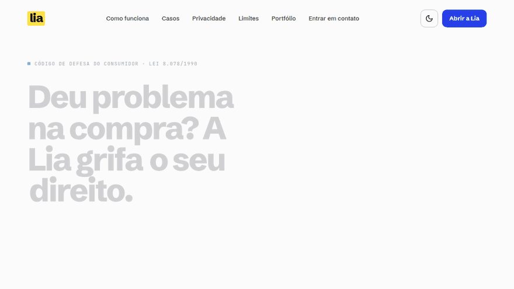

# Tendências em Ciência da Computação (2026/2)

Link do site abaixo:

[lia-consumidor.vercel.app](https://lia-consumidor.vercel.app)

[](https://lia-consumidor.vercel.app)

Repositório das atividades da disciplina Tendências em Ciência da Computação, do Centro
Universitário UDF, no segundo semestre de 2026.

A disciplina trata de Engenharia de Prompt e de aplicações de Inteligência Artificial. Ao
longo do semestre o foco é entender como os modelos generativos funcionam, como escrever
instruções para eles e em que pontos o resultado precisa ser conferido por uma pessoa.

- Professora: Kadidja Valéria (kadidja.oliveira@udf.edu.br)
- Estudante: Brayan A. Pletsch, RGM 38473585
- Turma: Engenharia de Software, N1, noturno (disciplina optativa)
- Avaliação prática: atividades de 0,5 ponto cada, somando 5,0 pontos na A2

## Organização

```
.
├── docs/                             plano de aulas e material da disciplina
├── aula-inaugural/                   missão de decolagem
├── unidade-1-fundamentos/            IA, LLMs e Engenharia de Prompt
├── unidade-2-programacao-assistida/  programação assistida e automação com IA
├── unidade-3-low-code/               projeto Low Code em grupo
├── unidade-4-aplicacoes-e-limitacoes/ agente de IA e ética (projeto final da A1)
└── LICENSE
```

Cada aula tem uma pasta com dois arquivos fixos:

- `README.md`, com o resumo da aula escrito por mim a partir dos slides e da bibliografia;
- `atividade.md`, com a entrega avaliada: o que foi feito, os resultados e a análise.

Quando a atividade tem código, ele fica numa subpasta (`codigo/` ou `experimentos/`). Nas
Unidades 1 e 2 ele roda só com o Python 3 instalado. Na Unidade 4, o agente é uma página HTML
com JavaScript que abre direto no navegador, e os testes rodam com Node.js. Os resultados
citados nos textos vêm da execução desses arquivos.

## Unidades

| Unidade | Tema | Situação |
|---|---|---|
| [Unidade 1](unidade-1-fundamentos/) | Fundamentos de IA e Engenharia de Prompt | concluída |
| [Unidade 2](unidade-2-programacao-assistida/) | Programação assistida e automação com IA | concluída |
| [Unidade 3](unidade-3-low-code/) | Low Code e No Code | projeto em grupo: protótipo montado e testado em parte |
| [Unidade 4](unidade-4-aplicacoes-e-limitacoes/) | Aplicações e limitações: agentes de IA e ética | projeto final da A1 (individual): agente de reclamação do consumidor |

## Como executar o código

Os scripts usam só a biblioteca padrão do Python.

```bash
python --version                 # 3.10 ou superior
cd unidade-1-fundamentos/aula-02-llms-e-sua-logica/experimentos
python proximo_token.py
```

Testes da aula 03:

```bash
cd unidade-1-fundamentos/aula-03-engenharia-de-prompt/codigo
python -m unittest test_valida_cpf -v
python comparar_versoes.py
```

Testes da Unidade 2:

```bash
cd unidade-2-programacao-assistida/aula-06-programacao-em-pares-com-ia/codigo
python -m unittest test_cep -v

cd ../../aula-08-automacao-com-ia/codigo
python -m unittest test_contar_niveis_log -v
```

Os testes do CEP não usam a rede. Só o `executar_casos.py` da aula 06 consulta o ViaCEP de
verdade e precisa de internet.

Agente da Unidade 4: abra
`unidade-4-aplicacoes-e-limitacoes/projeto-assistente-consumidor/agente/index.html` no
navegador para ver a apresentação do projeto, ou `agente/conversa.html` na mesma pasta para ir
direto para a Lia. As demonstrações da apresentação ficam em `conversa.html?exemplo=1` até
`?exemplo=4`. Para os testes (Node.js 18 ou mais novo):

```bash
cd unidade-4-aplicacoes-e-limitacoes/projeto-assistente-consumidor/agente
node testes/testes.js
```

## Uso de IA neste repositório

Usar IA generativa faz parte das atividades, então cada entrega diz qual ferramenta foi
usada, qual prompt foi enviado, o que voltou e o que eu fiz com a resposta. Nas atividades
de código da Unidade 2, as respostas da IA estão copiadas sem edição na pasta `prompts/` de
cada aula, e o código gerado ficou guardado separado da versão final para dar para
comparar.

Sigo o critério que a professora colocou em aula: a IA ajuda, mas quem responde pelo que é
entregue sou eu. Quando dava para verificar uma afirmação executando código, escrevi o
código e executei.
