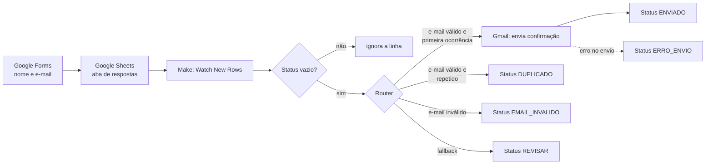

# Sistema de Cadastro e Automação de Usuários

Projeto prático da Unidade 3 (Low Code, No Code e Vibecode) da disciplina Tendências em
Ciência da Computação, UDF, 2026/2.

Aplicação: cadastro de pessoas por formulário online, com gravação automática numa
planilha e envio automático do e-mail de confirmação.

Integrantes:

- Brayan A. Pletsch
- Pedro Freire de Farias
- Davi José Nascimento

Plataformas: Make (plano gratuito), Google Forms, Google Sheets e Gmail.

Situação em 05/11/2026: o protótipo está montado (formulário, planilha e cenário no Make)
e passou pela maior parte dos testes de [casos-de-teste.md](casos-de-teste.md). Não
rodamos os casos T7, T9 e T10 nem conferimos o consumo de créditos.

## 1. O desafio

O problema que escolhemos é o cadastro de pessoas feito à mão. Normalmente alguém anota
os dados, passa tudo para uma planilha e ainda precisa mandar o e-mail de confirmação
para cada pessoa. Isso toma tempo, aumenta a chance de erro de digitação e às vezes a
pessoa demora para ter resposta.

O projeto ajuda quem recebe esses cadastros, como uma secretaria, um setor de atendimento
ou a organização de um evento, e também quem se cadastra.

Objetivo: a pessoa preenche um formulário online, os dados vão direto para uma planilha e
ela recebe um e-mail confirmando o cadastro, sem ninguém precisar fazer isso à mão.

Fica dentro do projeto: formulário com nome e e-mail, gravação automática na planilha,
conferência do e-mail digitado e envio da confirmação. Fica fora: login com senha, painel
de administração, aplicativo de celular, pagamento e banco de dados próprio.

Critérios de sucesso, definidos antes de montar:

1. em 10 cadastros de teste, todos aparecem na planilha sem perder nem repetir nenhum;
2. todo cadastro válido recebe o e-mail;
3. cadastro com e-mail inválido não é aceito;
4. o processo funciona do começo ao fim sem ninguém intervir.

O registro original das etapas 1 e 2, feito no formulário da professora em 15/10, está em
[registro-etapas-1-e-2.pdf](registro-etapas-1-e-2.pdf).

## 2. Por que o Make

Comparamos Make, Zapier, Airtable, Pipefy, Bubble e Adalo.

| Ferramenta | Por que ficou de fora ou foi escolhida |
|---|---|
| Bubble, Adalo | servem para criar aplicativos completos, e o desafio é bem mais simples |
| Pipefy | voltado para processos com etapas de aprovação |
| Airtable | guardaria os dados, mas sozinho não manda o e-mail |
| Zapier | no plano grátis, segundo o que levantamos em 15/10, cada automação podia ter só 2 passos e eram 100 tarefas por mês |
| Make | plano grátis com 1.000 créditos por mês e fluxo com vários passos, o que atende o protótipo |

O Google Forms grava as respostas direto numa planilha do Google Sheets, e o Make se
conecta ao Sheets e ao Gmail com o login da própria conta Google, sem chave de API.

Limites do plano gratuito que afetam o projeto: a página de preços do Make confirma 1.000
créditos por mês. Os outros dois limites que levantamos, 2 cenários ativos e intervalo
mínimo de 15 minutos, aparecem em guias sobre o plano, mas não estão na página oficial, então
o roteiro manda conferir na própria conta. A documentação do Make também confirma que um
gatilho como o Watch New Rows gasta 1 crédito a cada verificação, mesmo quando não acha
linha nova. Isso mudou o agendamento (seção 6, limitação 1).

## 3. Como o fluxo funciona



O e-mail passa por duas conferências. A primeira é no próprio formulário, que recusa um
endereço fora do formato antes de enviar e mostra uma mensagem para a pessoa corrigir. A
segunda é no Make, que confere de novo antes de mandar qualquer e-mail. A segunda pega o
que chegar na planilha por outro caminho, como uma linha digitada à mão.

A planilha tem três colunas preenchidas pelo formulário, duas calculadas por fórmula e
três preenchidas pelo Make:

| Coluna | Conteúdo | Quem preenche |
|---|---|---|
| A | Carimbo de data/hora | Forms |
| B | Nome completo | Forms |
| C | E-mail, como a pessoa digitou | Forms |
| D | E-mail normalizado: minúsculas e sem espaço nas pontas | fórmula |
| E | Ocorrência: 1 na primeira vez que o e-mail aparece, 2 ou mais quando repete | fórmula |
| F | Status: ENVIADO, DUPLICADO, EMAIL_INVALIDO, ERRO_ENVIO ou REVISAR | Make |
| G | Processado em | Make |
| H | Detalhe, com a mensagem de erro quando houver | Make |

Três decisões explicam o desenho:

- A repetição é contada na planilha, por fórmula. Assim não gasta crédito do Make e
  funciona mesmo quando a pessoa manda o formulário duas vezes seguidas e as duas linhas
  entram na mesma execução. Uma busca no Make pelo status das linhas anteriores não
  pegaria esse caso, porque nenhuma das duas estaria marcada ainda.
- Toda linha termina com um status. O filtro logo depois do gatilho só deixa passar linha
  com status vazio, então uma linha já tratada não recebe e-mail de novo.
- Se o Gmail falhar, uma rota de erro grava ERRO_ENVIO e a mensagem do erro, e o cenário
  continua com as outras linhas.

O e-mail de confirmação usa só o primeiro nome da pessoa:

```html
<p>Olá, {{escapeHTML(first(split(trim(1.Nome completo); space)))}}!</p>
<p>Recebemos o seu cadastro e ele está confirmado. Não é preciso fazer mais nada.</p>
<p>Se não foi você quem se cadastrou, responda a este e-mail para nos avisar.</p>
<p>Equipe do Sistema de Cadastro</p>
```

O `escapeHTML` impede que um nome com `<` ou `&` mude a formatação do e-mail.

A configuração campo a campo está em [guia-de-montagem.md](guia-de-montagem.md).

## 4. Integração com IA (vibecode)

A IA entrou só na construção. Nenhum dado de cadastro passa por serviço de IA durante o
funcionamento do sistema.

Usamos o Claude Opus 5.5 (Anthropic) em duas rodadas na mesma conversa. Os prompts e as
respostas, sem edição, estão em [prompts/](prompts/).

No [primeiro prompt](prompts/01-estrutura-do-cenario.md) passamos o problema, os limites
do plano gratuito, o que já tínhamos conferido na documentação do Make e as restrições:
só módulos do plano grátis, nenhum dado de cadastro indo para IA, fórmulas no formato do
Sheets em português e nada de inventar nome de módulo, campo ou função. A
[resposta](prompts/01-resposta-da-ia.md) trouxe o desenho do cenário, as colunas da
planilha, a regex do e-mail, a ideia de contar a repetição por fórmula e o texto do
e-mail, e terminou com uma lista do que a IA não tinha certeza.

Antes de aceitar, conferimos o que dava para conferir:

| O que a IA disse | Como conferimos | Resultado |
|---|---|---|
| o gatilho gasta 1 crédito por execução, mesmo sem linha nova | documentação de créditos do Make | certo |
| agendar a cada 15 minutos estoura os 1.000 créditos do mês | conta com o dado acima: cerca de 2.880 verificações por mês | certo, e mudou o plano da etapa 2 |
| Router e filtros não gastam crédito | documentação de créditos do Make | certo |
| a regex aceita os 2 exemplos válidos e recusa os 5 inválidos que ela listou | testamos no Node, que usa o mesmo tipo de regex do Make (ECMAScript) | certo |
| conta Gmail pessoal precisa de cliente OAuth próprio no Google Cloud | documentação atual do Gmail no Make (versão 4) | desatualizado: hoje a conexão é por "Sign in with Google" |
| o manipulador de erro se chama Ignore | documentação de tratamento de erros do Make | desatualizado: hoje se chama Skip |
| no Forms, usar Validação de resposta > Texto > Endereço de e-mail | ajuda do Google Forms em português | não encontramos essa opção; a ajuda mostra Expressão regular |
| a rota "Revisar" precisa de um filtro próprio | documentação do Router | o Router tem rota de fallback, que resolve sem filtro |

Nos nossos testes da regex apareceram duas brechas que a IA não tinha citado: ela aceitava
e-mail começando com ponto (`.ana@gmail.com`) e domínio começando com hífen
(`ana@-gmail.com`).

No [segundo prompt](prompts/02-ajustes.md) mandamos as correções e as duas brechas, e
pedimos a regex corrigida, uma versão para o Forms aceitando espaço antes e depois (o
celular costuma pôr um espaço no fim), a lista final de módulos com rota de fallback, as
fórmulas com nomes em inglês e o e-mail assinado. A
[resposta](prompts/02-resposta-da-ia.md) fechou as duas brechas e explicou por que
deixaria outras três abertas (`ana.@gmail.com`, `ana..silva@gmail.com` e
`ana@gmail-.com`): fechar quase dobraria o tamanho da expressão, e o pior caso é o Gmail
recusar o envio.

Testamos de novo:

- a regex do Make passou nos 21 casos que montamos, no Node;
- a regex do Forms passou em 25 casos no RE2, o motor que o Google Forms usa, incluindo
  espaço antes e depois do e-mail;
- o RE2 recusou expressão com lookahead, o que confirma o motivo que a IA deu para não
  usar esse recurso;
- a lógica das duas fórmulas (normalizar e contar a ocorrência de cima para baixo) foi
  simulada com uma sequência de cadastros parecida com a dos testes e deu os valores
  esperados;
- as funções do Make usadas no mapeamento (`formatDate` com fuso, `first`, `split`, `trim`
  e `escapeHTML`) estão na documentação.

Algumas coisas só dava para conferir com a conta. Na primeira execução, em 05/11, a
resposta de teste passou pelo filtro de status vazio, então o operador Does not exist trata
célula vazia como inexistente. Depois que o Make gravou o status, as colunas D e E
continuaram calculadas, ou seja, o Update a Row não mexe nas colunas deixadas em branco no
módulo. No P2, sem resposta nova, o gatilho não devolveu nenhuma linha, então o Make
também ignora as linhas em que as fórmulas devolvem vazio.

### O que mudou na montagem

Na hora de montar, três coisas na tela não batiam com o que estava escrito:

- O Google Sheets criou a aba de respostas como tabela, e tabela não aceita fórmula na
  linha de cabeçalho. Tivemos que desfazer a tabela antes de colar as fórmulas de D1 e E1.
- O operador do filtro aparece como Does not exist. No segundo prompt nós o chamamos de
  Not exists.
- Digitamos o formato da data sem aspas e o editor do Make tratou cada `/` como operador.
  A data foi gravada como `2026-11-05T16:43:44.930-03:00` em vez de `05/11/2026 16:43`. Na
  documentação de funções de data do Make o texto fixo aparece entre aspas. Com as aspas,
  a data do T1 saiu como `05/11/2026 17:15`.

O [guia de montagem](guia-de-montagem.md) já está com essas correções.

## 5. Testes e segurança

Os casos estão em [casos-de-teste.md](casos-de-teste.md): três verificações antes de
começar, quatro envios que o formulário tem que barrar, dez casos do fluxo completo (com
onze envios) e cinco verificações de segurança. Cada critério de sucesso da etapa 1 tem
pelo menos um caso ligado a ele, e o T10 roda com o agendamento ligado para conferir o
critério "sem ninguém intervir".

Resultados, em 05/11/2026:

- Rodamos 8 dos 11 envios do fluxo completo. Todos apareceram na planilha e nenhum foi
  tratado duas vezes.
- Os cadastros válidos (T1, T2, T3, o primeiro envio do T5, T6 e T8) ficaram com status
  ENVIADO, e o e-mail chegou só com o primeiro nome, com acento ("Olá, José!") e também
  no domínio com subdomínio do T8.
- O endereço digitado com maiúsculas e espaços (T3) foi normalizado na coluna D e recebeu
  o e-mail.
- O e-mail repetido em outra execução (T4) e o segundo envio seguido da mesma pessoa (T5)
  ficaram como DUPLICADO. No T5 a caixa recebeu um e-mail só.
- O nome com HTML (T6) apareceu no e-mail como texto.
- O formulário recusou e-mail sem @, sem terminação ou começando com ponto, e também o
  envio com nome em branco. A recusa aconteceu na tela e no servidor do Google.
- Uma execução sem resposta nova (P2) não devolveu nenhuma linha. O painel do módulo
  mostrou 0 crédito nessa execução, e a documentação do Make diz que o gatilho gasta 1
  crédito por verificação. Não conferimos o consumo total no painel da organização.

Ficaram sem teste o e-mail inválido chegando ao Make por outro caminho (T7), a falha
forçada no Gmail (T9) e o agendamento automático (T10). Com isso, o critério de funcionar
sem ninguém intervir não foi verificado, e a rota de erro do Gmail foi montada mas não
chegou a ser usada.

Cuidados de segurança e privacidade do desenho:

- nenhum dado de cadastro vai para IA;
- o formulário não pede login e só coleta nome e e-mail;
- a planilha tem acesso restrito (hoje só a conta dona), e as colunas de fórmula e de
  status têm aviso de proteção;
- as conexões com Google ficam guardadas no Make, e o blueprint exportado não leva senha
  nem token;
- o link do formulário não vai para o repositório, porque qualquer pessoa poderia mandar
  cadastros e gastar os créditos e a cota de envio do Gmail;
- nos testes usamos dados fictícios e caixas de e-mail temporárias.

## 6. Reflexão crítica

### Vantagens

1. Montar sem servidor. Ler a planilha, decidir o que fazer, mandar o e-mail e marcar a
   linha são módulos prontos. Em código seria preciso hospedar um serviço, autenticar no
   Google e tratar a API do Gmail. No Make o trabalho ficou concentrado nas regras.
2. Regras que dá para ver. Cada rota tem um filtro com nome (Confirmar, Duplicado,
   Inválido), e a planilha mostra o status de cada cadastro. Quem não programa consegue
   abrir o cenário e entender por que uma pessoa não recebeu o e-mail.
3. Quem usa continua nas ferramentas que conhece. A secretaria abre a mesma planilha de
   sempre, agora com duas colunas a mais, e o formulário é um Google Forms comum. O
   custo é zero dentro dos limites do plano grátis.

### Limitações

1. O plano gratuito decide o ritmo. Como cada verificação da planilha gasta crédito
   mesmo sem cadastro novo, o intervalo de 15 minutos não cabe nos 1.000 créditos do mês.
   Com 60 minutos, a pessoa pode esperar até uma hora pelo e-mail e sobram créditos para
   cerca de 140 cadastros por mês. Na etapa 2 tínhamos olhado os limites separados. Foi a
   IA que juntou os dois na conta, e conferimos o consumo do gatilho na documentação.
2. O sistema depende de a planilha não ser mexida. O Make controla o que já leu pela
   posição das linhas, e as fórmulas ficam em colunas que qualquer pessoa com acesso pode
   apagar. Uma linha apagada, uma ordenação ou uma célula digitada em cima da fórmula
   faz cadastros serem pulados ou marcados errado. Isso é regra de uso, e a plataforma
   não tem como garantir.
3. Validar formato não é validar endereço. A regex confere se o texto parece um e-mail,
   mas `ana@gmial.com` passa. Ela ainda aceita alguns formatos estranhos que escolhemos
   não fechar. E os dados passam por Google e Make, então um uso real precisaria de aviso
   de privacidade no formulário, por causa da LGPD.

## 7. Evidências

Os prints ficam em `evidencias/`, com os endereços de e-mail borrados.

| Arquivo | O que mostra |
|---|---|
| [validacao-formulario.png](evidencias/validacao-formulario.png) | mensagem de erro do formulário para dois e-mails inválidos |
| [planilha-colunas.png](evidencias/planilha-colunas.png) | aba de respostas com as colunas D a H, depois da primeira execução |
| [cenario-make.png](evidencias/cenario-make.png) | cenário com as quatro rotas e a rota de erro do Gmail |
| [filtro-confirmar.png](evidencias/filtro-confirmar.png) | filtro da rota Confirmar |
| [email-recebido.png](evidencias/email-recebido.png) | e-mail de confirmação do T2 |
| [planilha-apos-testes.png](evidencias/planilha-apos-testes.png) | planilha com os status depois dos testes |
| [email-html-como-texto.png](evidencias/email-html-como-texto.png) | e-mail do T6, com o HTML do nome como texto |
| [execucao-sem-dados.png](evidencias/execucao-sem-dados.png) | execução do P2, em que o gatilho não devolveu nenhuma linha |

Não temos o print do formulário aberto, o do histórico de execuções e o da execução
com erro, que dependia do T9. O blueprint do cenário não foi exportado.

## 8. Próximos passos

- Confirmar que o endereço existe com um link de confirmação no e-mail, em vez de
  confirmar o cadastro direto.
- Se o volume crescer, trocar a verificação periódica por um gatilho instantâneo a partir
  do envio do formulário, que não gasta crédito quando não há cadastro.
- Pôr aviso de privacidade no formulário e definir por quanto tempo os dados ficam na
  planilha.
- Seguir o roteiro da apresentação de exemplo da professora: autenticação, painel para
  quem recebe os cadastros e banco de dados próprio.

## Apresentação

[slides/apresentacao.pptx](slides/apresentacao.pptx)

## Uso de IA e fontes

Ferramenta de IA: Claude Opus 5.5 (Anthropic), usada no vibecode (seção 4) e também como
apoio na redação desta documentação. Os resultados de teste citados aqui vêm das
execuções descritas.

Fontes:

- OLIVEIRA, Kadidja Valéria Reginaldo de. Orientação para o Projeto Low Code / No Code /
  Vibecode, cronograma e formulário de acompanhamento. 2026. Em [../material/](../material/).
- MAKE. Google Sheets modules. https://apps.make.com/google-sheets-modules
- MAKE. Gmail. https://apps.make.com/google-email
- MAKE. How features use credits. https://help.make.com/how-features-use-credits
- MAKE. Router. https://help.make.com/router
- MAKE. Filtering. https://help.make.com/filtering
- MAKE. Skip error handler. https://help.make.com/skip-error-handler
- MAKE. Date and time functions; Text and binary functions; Array functions.
  https://help.make.com/date-and-time-functions
- MAKE. Pricing. https://www.make.com/en/pricing
- GOOGLE. Como definir regras para seu formulário. Ajuda do Editores de arquivos Google.
  https://support.google.com/docs/answer/3378864?hl=pt-BR
