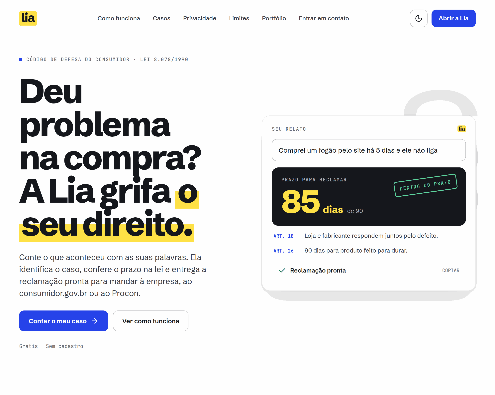
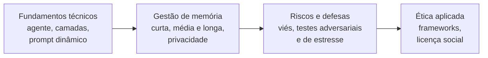

# Unidade 4: Aplicações e limitações (agentes e ética)

Em novembro, a disciplina estudou agentes de IA, chatbots, viés algorítmico e
responsabilidade social. As tarefas da unidade formam o projeto final da A1, que vale até
5,0 pontos. Fiz o projeto sozinho.

O projeto é a [Lia, assistente de reclamação do consumidor](projeto-assistente-consumidor/).
Você conta o problema que teve com uma compra ou com um serviço, e ela responde com o que a
lei garante, o prazo para reclamar e um texto de reclamação pronto. Ela está no ar em
[lia-consumidor.vercel.app](https://lia-consumidor.vercel.app).

## Entregas da A1

| Data | Tarefa | Valor | Onde está |
|---|---|---|---|
| 05/11 | Criação de agentes de IA | 1,0 | O código em [agente/](projeto-assistente-consumidor/agente/) e as seções 4 a 7 do [README do projeto](projeto-assistente-consumidor/README.md): modelo generativo ou agente, quatro camadas, prompt dinâmico e memória |
| 12/11 | Chatbot e ferramentas de chatbot, com a especificação | 1,0 | A [especificação](projeto-assistente-consumidor/especificacao-do-chatbot.md), nas 11 etapas do Serpro Bots; o [site do projeto](projeto-assistente-consumidor/agente/index.html), a [conversa](projeto-assistente-consumidor/agente/conversa.html) e o [design system](projeto-assistente-consumidor/agente/design-system.html) |
| 19/11 | Viés algorítmico e responsabilidade social | 1,0 | A análise em [etica-e-vies.md](projeto-assistente-consumidor/etica-e-vies.md) e os testes de equidade em [casos-de-teste.md](projeto-assistente-consumidor/casos-de-teste.md) |
| 26/11 | Apresentação do projeto de solução inteligente | 1,0 | Os [slides](projeto-assistente-consumidor/slides/apresentacao.pptx) e a demonstração ao vivo em `conversa.html?exemplo=1` até `?exemplo=4` |
| 26/11 | Integrar conceitos em solução aplicada: repositório GitHub | 1,0 | Este repositório, com as quatro unidades da disciplina |

## O que o guia da A1 pede

O guia de estudos da professora
([material/guia-a1-agentes-de-ia-e-etica.pdf](material/guia-a1-agentes-de-ia-e-etica.pdf))
divide a unidade em quatro etapas:

Em palavras simples, e com o lugar onde cada ideia aparece na Lia:

| Ideia do guia | O que quer dizer | Onde aparece na Lia |
|---|---|---|
| Modelo generativo ou agente | Um modelo generativo responde a um pedido isolado. Um agente age, guarda o contexto da conversa e tem autonomia, e por isso pede mais responsabilidade de quem o constrói | Seção 4 do [README do projeto](projeto-assistente-consumidor/README.md#4-modelo-generativo-ou-agente) |
| Quatro camadas | A perceptiva recebe o que vem de fora, a cognitiva entende a intenção, a decisória confere regras e a executiva age | Seção 5: `perceber`, `entender`, `decidir` e `executar` |
| Interpretabilidade | Dá para confiar no agente quando dá para explicar por que ele tomou cada decisão | O botão "Por que recebi esta resposta?", em toda resposta |
| Prompt dinâmico | O prompt deixa de ser um texto fixo e vira um modelo com espaços que se preenchem durante a conversa | Seção 6: o texto da reclamação |
| Memória em três níveis | Curta, média e longa. Quanto mais o agente lembra, maior o risco para a privacidade | Seção 7: 6 mensagens, a ficha do caso e nenhuma memória longa |
| Privacidade desde o projeto | Coletar o mínimo, proteger o que for guardado (criptografia e controle de acesso) e pedir consentimento novo (LGPD) quando conversas antigas forem usadas para outra coisa | A Lia apaga CPF, telefone, e-mail e cartão e não guarda nada |
| Três tipos de viés | Nos dados (quem não está representado), no algoritmo (escolhas de quem desenvolve) e na aplicação (usar o sistema onde ele não serve) | Seção 8 e [etica-e-vies.md](projeto-assistente-consumidor/etica-e-vies.md) |
| Custo de mitigar | Às vezes a solução mais justa sacrifica um pouco de eficiência | A correção de "colocaram" virando "clonaram" fez "golpi" deixar de ser reconhecido |
| Avaliar além da acurácia | Olhar confiança, robustez e impacto real, com testes adversariais e de estresse | Seção 10 e [casos-de-teste.md](projeto-assistente-consumidor/casos-de-teste.md) |
| Três frameworks éticos | Consequencialista (olha o resultado), deontológico (olha as regras que não se quebram) e das virtudes (olha o que uma pessoa íntegra faria) | Os três dilemas de [etica-e-vies.md](projeto-assistente-consumidor/etica-e-vies.md) |
| Licença social para operar | A sociedade aceita o sistema quando há accountability, participação e remediação | A tabela dos três pilares, com o que falta em cada um |
| Documentar como gestão de risco | Registrar cada escolha técnica, dentro de um ciclo de melhoria: coletar, analisar, decidir, implementar e validar | As duas rodadas de teste, a validação e a especificação |

## A aula de chatbots

A aula sobre chatbots indicou o
[fluxo de trabalho do Serpro Bots](https://serprobots.estaleiro.serpro.gov.br/docs/dev/),
que organiza a criação de um chatbot em 11 etapas:

1. entender a necessidade;
2. montar a estrutura;
3. criar a identidade visual e a persona;
4. coletar o acervo;
5. modelar;
6. revisar os textos (UX Writing);
7. implementar;
8. testar;
9. homologar;
10. implantar;
11. fazer a curadoria.

A [especificação da Lia](projeto-assistente-consumidor/especificacao-do-chatbot.md) segue
essas etapas, uma por seção.

## Material

| Arquivo | O que é |
|---|---|
| [material/guia-a1-agentes-de-ia-e-etica.pdf](material/guia-a1-agentes-de-ia-e-etica.pdf) | Guia de estudos A1 da professora: arquitetura, memória, privacidade, viés e responsabilidade social |

O aviso de 26/11 pediu que cada estudante ou grupo registre seus dados e o link do
repositório na tabela de entrega da professora.
