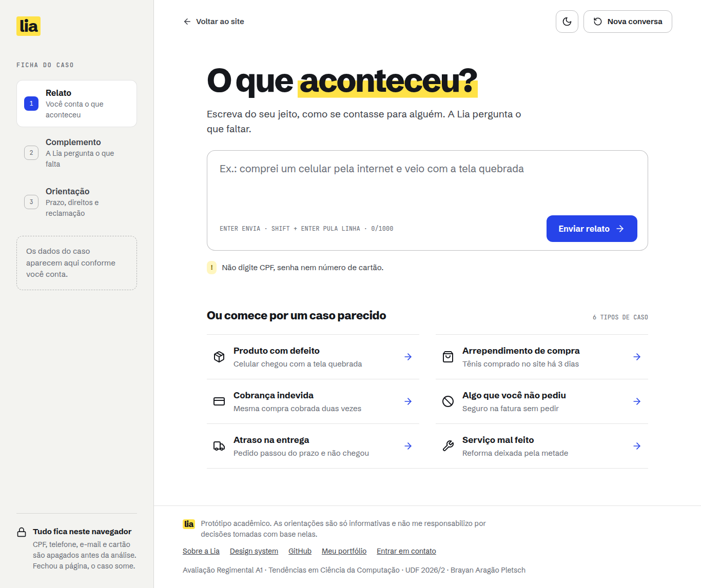
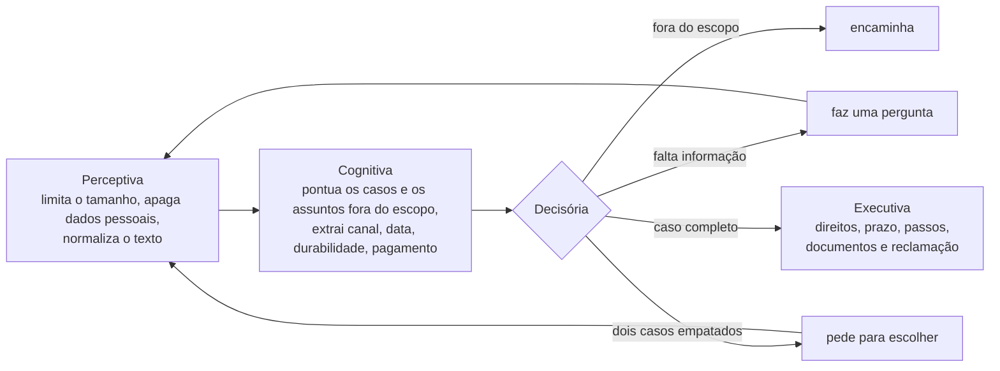

# Lia: assistente de reclamação do consumidor

Projeto final da Unidade 4 (Aplicações e Limitações: agentes e ética) da disciplina
Tendências em Ciência da Computação, UDF, 2026/2. Faz parte da avaliação A1.

| Campo | Informação |
|---|---|
| Estudante | Brayan A. Pletsch |
| RGM | 38473585 |
| Turma | Engenharia de Software, N1, noturno (disciplina optativa) |
| Professora | Kadidja Valéria |
| Data | 26/11/2026 |

A Lia é um agente que roda no navegador. A pessoa conta, do jeito dela, o problema que teve
com uma compra ou com um serviço. A Lia identifica o tipo de caso, pergunta o que faltar,
confere os prazos e as regras do Código de Defesa do Consumidor (CDC) e devolve a
orientação junto com um texto de reclamação pronto para mandar à empresa, ao
consumidor.gov.br ou ao Procon.

Para usar, basta abrir no navegador a [página de apresentação](agente/landing.html) ou ir
direto para a Lia em [agente/index.html](agente/index.html). Não precisa instalar nada nem ter
chave de API.



A tabela que liga cada tarefa da unidade a um arquivo está no
[README da unidade](../README.md).

## 1. O problema

Em 2024 o Consumidor.gov.br finalizou 1.414.218 reclamações, e 82,32% delas foram
resolvidas pelas empresas (boletim de 2024 da Senacon). A plataforma funciona quando a
reclamação chega, mas antes disso a pessoa precisa saber se tem direito, qual é o prazo e o
que pedir. As regras do CDC têm prazos curtos e alguns detalhes que confundem:

- desistir de uma compra em até 7 dias só vale quando ela foi feita fora da loja (internet,
  telefone, em casa). Numa loja física, a troca de um produto sem defeito depende da
  política da loja;
- para reclamar de defeito, o prazo é de 30 dias para o que acaba rápido e de 90 dias para o
  que é feito para durar, e a contagem muda quando o defeito estava escondido;
- a devolução em dobro de uma cobrança indevida vale para o que já foi pago, e não para a
  cobrança em si.

Sem saber essas regras, a pessoa corre o risco de desistir, de reclamar fora do prazo ou de
pedir uma coisa a que não tem direito. O público da Lia é quem compra pela internet, recebe
uma fatura errada ou contrata um serviço mal feito, não tem advogado e não sabe por onde
começar.

## 2. Escopo

A Lia conhece seis tipos de caso:

| Caso | Exemplo de relato | Base no CDC |
|---|---|---|
| Produto com defeito | "o celular veio com a tela quebrada" | arts. 18 e 26 |
| Arrependimento de compra | "comprei no site e não gostei, quero devolver" | art. 49 |
| Cobrança indevida | "me cobraram duas vezes no cartão" | art. 42 |
| Produto ou serviço que a pessoa não pediu | "colocaram um seguro que eu nunca pedi" | arts. 39 e 42 |
| Atraso na entrega ou oferta não cumprida | "meu pedido não chegou e já passou do prazo" | arts. 30 e 35 |
| Serviço mal feito | "o pedreiro deixou a obra pela metade" | arts. 20 e 26 |

Ela também reconhece cinco assuntos que o CDC não cobre ou que exigem outro tipo de ajuda.
Nesses casos ela não orienta: explica por quê e diz a quem procurar.

| Assunto | Para onde a Lia encaminha |
|---|---|
| Trabalho (patrão, salário, demissão) | sindicato, Superintendência Regional do Trabalho ou Defensoria |
| Aluguel | Defensoria Pública (o contrato segue a Lei do Inquilinato) |
| Compra entre duas pessoas | Juizado Especial Cível; boletim de ocorrência se houve golpe |
| Golpe | banco e boletim de ocorrência, antes de qualquer reclamação |
| Acidente ou dano à saúde | atendimento de saúde, Procon ou Defensoria |

A Lia não manda a reclamação sozinha, não calcula indenização, não guarda conversa e não
acessa nenhum sistema de empresa ou de governo.

## 3. Modelo generativo ou agente?

O guia da A1 separa os dois pela ação, pelo contexto e pela autonomia. A Lia decide qual
regra aplicar, pergunta o que falta e produz um resultado (a orientação e a reclamação), e
mantém o contexto do caso enquanto a conversa dura. A ação final no mundo, que é enviar a
reclamação, eu deixei de propósito com a pessoa. Uma reclamação mandada em nome de alguém,
com um prazo calculado errado, causa um dano difícil de desfazer.

A Lia não usa modelo de linguagem. A camada cognitiva funciona com gatilhos e regras
escritos por mim, conferidos no texto do CDC. Escolhi assim por três motivos: cada resposta
pode ser explicada (o princípio da interpretabilidade do guia), nada do que a pessoa digita
sai do computador dela e não existe custo por uso. O preço dessa escolha aparece nos testes:
com frases que ela nunca viu, a Lia acertou o caso em 4 de 12 (seção 9).

## 4. Arquitetura em quatro camadas



| Camada | O que faz na Lia | Função em [agente.js](agente/agente.js) |
|---|---|---|
| Perceptiva | Lê até 1.000 caracteres, apaga CPF, telefone, e-mail e número de cartão antes de qualquer análise e normaliza o texto (minúsculas, sem acento) | `perceber` |
| Cognitiva | Dá pontos a cada caso conforme os gatilhos encontrados, com tolerância a erro de digitação, e extrai onde a compra foi feita, há quantos dias, se o produto dura, se a pessoa já pagou e se havia prazo de entrega | `entender` |
| Decisória | Encaminha os assuntos fora do escopo, escolhe o caso (com regra de precedência e pergunta quando há empate), pergunta o que falta e aplica os prazos dos arts. 26 e 49 | `decidir` |
| Executiva | Monta a resposta: o que a lei garante, a situação do prazo, os passos, os documentos e o texto da reclamação | `executar` |

Toda resposta traz o botão "Por que recebi esta resposta?". Ele mostra as palavras que
indicaram o caso, as regras aplicadas, os artigos usados e a confiança na identificação.

### A interface

São três páginas, todas em `agente/`. A [landing](agente/landing.html) apresenta o projeto, a
[Lia](agente/index.html) é a conversa e o [design system](agente/design-system.html) documenta
as cores, a tipografia, os movimentos e todos os componentes. A ideia do visual é "a lei,
grifada": tinta e papel para quase tudo, um azul cobalto para as ações e o amarelo de
marca-texto só no que decide, como o prazo e os campos que a pessoa precisa completar.

Os estilos começam por `tokens.css` (as cores do tema claro e do escuro), `base.css` e
`componentes.css`, que as três páginas usam. Depois vem o arquivo de cada página: `layout.css`
na Lia, `landing.css` na landing e `guia.css` no design system. Os componentes usam só os
tokens, então o tema escuro troca os valores e nunca os nomes. O tema escolhido numa página
vale na outra, e o design system fica sempre no claro.

No JavaScript, cada parte tem um papel. O agente (`agente.js`) não conhece a tela. Os
componentes (`ui/componentes.js`) recebem dados e devolvem elementos, sem guardar estado. O
controlador (`ui/aplicacao.js`) guarda a conversa e liga os eventos. A página do design system
usa os mesmos componentes e monta os exemplos pedindo respostas reais ao agente, e a tabela de
cores lê os valores do próprio `tokens.css`, então nada da tela é copiado à mão. Todo texto
que vem da pessoa entra na página com `textContent`, nunca como HTML.

Os ícones são SVG escritos no código, a partir do Lucide (licença ISC). As fontes Schibsted
Grotesk e JetBrains Mono vêm do Google Fonts; se elas não carregarem, a página usa a fonte do
sistema. A outra coisa de fora é o formulário de contato da landing, que manda nome, e-mail,
assunto e mensagem para o meu e-mail pelo serviço FormSubmit. É a única parte do site que
envia dados pela internet; a conversa com a Lia continua só no navegador.

O botão "Baixar registro da sessão" saiu da tela. O registro de curadoria continua no agente,
na função `verRegistro()`, que os testes usam.

| Tela | Arquivo |
|---|---|
| Landing, a página de apresentação | [evidencias/landing.png](evidencias/landing.png) |
| Início, com os seis tipos de caso | [evidencias/inicio.png](evidencias/inicio.png) |
| Conversa completa sobre um fogão com defeito | [evidencias/demo-1.png](evidencias/demo-1.png) |
| Compra em loja física, sem reclamação | [evidencias/demo-2.png](evidencias/demo-2.png) |
| Cobrança em dobro com CPF digitado | [evidencias/demo-3.png](evidencias/demo-3.png) |
| Caso trabalhista, fora do escopo | [evidencias/demo-4.png](evidencias/demo-4.png) |
| Tema escuro | [evidencias/tema-escuro.png](evidencias/tema-escuro.png) |
| Tela de celular | [evidencias/celular.png](evidencias/celular.png) |
| Design system | [evidencias/design-system.png](evidencias/design-system.png) |

## 5. Do prompt estático ao dinâmico

O guia mostra o prompt de um agente como um modelo com campos que se preenchem durante a
conversa. Na Lia, o texto da reclamação funciona assim. Cada caso tem um modelo, e os campos
vêm da ficha da conversa:

```
Em [data da compra], {comprei | contratei} {produto}{onde comprou}{valor}. {descrição do caso}

Por isso, peço {pedido do caso, com o artigo do CDC}.
```

O que a Lia não sabe fica entre colchetes, como `[nome da empresa]` e `[descreva o defeito]`,
para a pessoa completar. Preferi isso a deixar a Lia supor um dado. O pedido também muda com a
ficha. Numa cobrança indevida ainda não paga, por exemplo, ela pede o cancelamento da
cobrança, e não a devolução em dobro, que só vale para o que já foi pago.

## 6. Memória

| Memória | Na Lia | Por quê |
|---|---|---|
| Curta | As 6 últimas mensagens da conversa | É o que basta para entender a resposta a uma pergunta |
| Média | A ficha do caso: tipo, produto, onde comprou, há quantos dias, se pagou | Aparece no painel "Ficha do caso" e é apagada quando a orientação sai |
| Longa | Não existe | Guardar o histórico de reclamações de alguém cria um perfil de consumo e de conflitos, e a Lia não precisa disso para funcionar |

O guia diz que mais memória dá mais contexto e mais risco de privacidade. Aqui a escolha foi
abrir mão da memória longa. O custo é que a pessoa precisa contar o caso de novo se voltar
outro dia.

## 7. Privacidade, viés e ética

A análise completa está em [etica-e-vies.md](etica-e-vies.md). O resumo:

- A Lia coleta o mínimo. Ela não pede nenhum dado pessoal e apaga os que a pessoa digitar.
  Como tudo roda no navegador, nada da conversa é transmitido nem guardado. O formulário de
  contato da landing é à parte e avisa que envia o que a pessoa escreve nele.
- Os testes mostraram viés de dados. Na primeira rodada, a Lia entendeu 6 de 6 relatos em
  linguagem formal e 3 de 6 com expressão regional ("arriou", "deu prego", "não veio",
  "serviço porco").
- Também mostraram viés de algoritmo, causado por uma escolha minha. A tolerância a erro de
  digitação fez "colocaram" virar "clonaram", e quem reclamava de um seguro não pedido era
  mandado para o tratamento de golpe.
- O viés de aplicação foi tratado com os cinco assuntos fora do escopo. O CDC aplicado a um
  problema de aluguel ou de trabalho daria uma orientação errada com cara de certa.

## 8. Especificação do chatbot

A especificação segue as 11 etapas do fluxo de trabalho do Serpro Bots, do Documento de
Visão à curadoria: [especificacao-do-chatbot.md](especificacao-do-chatbot.md).

## 9. Testes

A bateria fica em [agente/testes.js](agente/testes.js) e os resultados em
[casos-de-teste.md](casos-de-teste.md).

| Rodada | Resultado |
|---|---|
| Primeira, antes de qualquer ajuste | 46 de 53 testes |
| Segunda, depois de corrigir o viés de algoritmo e acrescentar as expressões regionais | 55 de 55 (53 originais e 2 de regressão) |
| Validação com 12 frases novas, que não foram usadas no ajuste | 4 de 12 casos identificados |

A segunda rodada passa inteira porque eu acrescentei exatamente as expressões que tinham
falhado. A validação existe para medir isso: com frases que a Lia nunca viu, ela acerta
pouco. Em 7 dos 8 erros ela respondeu que não entendeu, pede para a pessoa contar de outro
jeito e, na segunda vez, indica o Procon. No oitavo ("o anúncio dizia frete grátis e me
cobraram o frete") ela tratou como cobrança indevida, com confiança baixa, o que não chega a
ser absurdo para esse relato.

## 10. Vantagens e limitações

Vantagens:

1. Cada resposta pode ser explicada. A pessoa vê as palavras que contaram, a regra aplicada
   e o artigo usado, e pode discordar com base nisso.
2. Roda no navegador, sem custo, e o relato não sai do computador da pessoa. A página pode ser
   aberta num computador de biblioteca ou de um posto do Procon.
3. A Lia recusa quando não há base. Na compra em loja física ela explica que o art. 49 não se
   aplica e não gera uma reclamação que a pessoa perderia.

Limitações:

1. Generaliza mal. Gatilhos escritos à mão não cobrem o jeito como cada pessoa fala, e a
   validação mostrou isso (4 de 12).
2. Os prazos dependem do que a pessoa informa. Se ela errar a data, a Lia calcula errado.
3. Não testei com usuários reais. Os relatos dos testes foram escritos por mim, inclusive os
   regionais.

## 11. Próximos passos

- Fazer a curadoria das 8 frases que a validação não entendeu e montar um conjunto de
  validação novo para medir de novo.
- Testar com pessoas de fora do curso, de preferência idosos e pessoas de outras regiões, e
  ouvir alguém do Procon sobre os casos mais comuns.
- Avaliar um modelo de linguagem só na camada cognitiva, para identificar o caso, mantendo a
  decisão nas regras. Isso melhoraria a generalização, mas o texto da pessoa passaria a sair
  do navegador, e o custo e o risco de erro do modelo entrariam na conta.
- Acrescentar casos de banco, telefonia e plano de saúde, que têm regras próprias além do
  CDC.

## 12. Como rodar

1. Abra [agente/landing.html](agente/landing.html) para ver a apresentação do projeto, ou
   [agente/index.html](agente/index.html) para ir direto para a Lia. Os cartões de caso da
   landing abrem a Lia com o relato já escrito no campo (`index.html?relato=...`), sem enviar.
2. Para as demonstrações da apresentação, abra `index.html?exemplo=1` até `?exemplo=4`:
   fogão com defeito, compra em loja física, cobrança em dobro com CPF digitado e um caso
   trabalhista. Acrescentar `&tema=escuro` força o tema escuro, e `&foto` mostra a página
   inteira sem rolagem, que é como as telas de `evidencias/` foram tiradas.
3. O design system fica em [agente/design-system.html](agente/design-system.html).
4. Para rodar os testes (Node.js 18 ou mais novo):

```bash
cd unidade-4-aplicacoes-e-limitacoes/projeto-assistente-consumidor/agente
node testes.js
```

Para ter uma versão online, dá para ligar o GitHub Pages do repositório (Settings > Pages >
branch `main`). A Lia fica em
`https://brayanpletsch.github.io/Tendencias_CienciaComputacao_2026_2/unidade-4-aplicacoes-e-limitacoes/projeto-assistente-consumidor/agente/`
e a landing no mesmo endereço, terminado em `landing.html`.

O formulário de contato usa o FormSubmit. Na primeira mensagem, o serviço manda para o
endereço do formulário um e-mail de ativação, que precisa ser confirmado. Depois disso ele
envia um código que pode substituir o endereço no `action` do formulário.

## Estrutura

```
projeto-assistente-consumidor/
├── README.md                      este documento
├── especificacao-do-chatbot.md    as 11 etapas do fluxo do Serpro Bots
├── etica-e-vies.md                privacidade, viés, frameworks éticos e licença social
├── casos-de-teste.md              rodadas de teste, validação e equidade
├── agente/
│   ├── landing.html               página de apresentação do projeto
│   ├── index.html                 a tela do chat
│   ├── design-system.html         cores, tipos, movimentos e componentes
│   ├── favicon.svg, favicon.ico   ícone da aba (e apple-touch-icon.png, para o celular)
│   ├── agente.js                  as quatro camadas
│   ├── base-conhecimento.js       casos, gatilhos, artigos e textos da Lia
│   ├── testes.js                  bateria de testes
│   ├── resultado-dos-testes.txt   saída da última execução
│   ├── estilos/                   tokens.css, base.css, componentes.css, layout.css, landing.css, guia.css
│   └── ui/                        icones.js, componentes.js, tema.js, aplicacao.js, landing.js, design-system.js
├── evidencias/                    telas da landing, da Lia e do design system
└── slides/apresentacao.pptx       apresentação final
```

## Uso de IA

Usei o Claude (Anthropic) como apoio para programar o agente e revisar os textos. O visual foi
desenhado com o Claude Design e implementado com o Claude Code. As regras jurídicas foram
conferidas no texto oficial do CDC, e os números de teste citados aqui vêm da execução de
[agente/testes.js](agente/testes.js). A Lia em si não usa IA generativa.

## Referências

- BRASIL. Lei nº 8.078, de 11 de setembro de 1990. Código de Defesa do Consumidor.
  https://www.planalto.gov.br/ccivil_03/leis/l8078compilado.htm
- BRASIL. Lei nº 9.099, de 26 de setembro de 1995. Juizados Especiais Cíveis e Criminais.
- BRASIL. Ministério da Justiça e Segurança Pública. Senacon. Boletim Consumidor.gov.br 2024.
  https://www.gov.br/mj/pt-br/assuntos/seus-direitos/consumidor/defesadoconsumidor/Biblioteca/boletins-1/boletim-consumidor-gov-br-2024.pdf
- SERPRO. Serprobots: fluxo de trabalho para desenvolver chatbots.
  https://serprobots.estaleiro.serpro.gov.br/docs/dev/
- OLIVEIRA, Kadidja Valéria Reginaldo de. Guia de estudos A1: criação de agentes de IA e ética
  aplicada. 2026. Em [../material/](../material/).
