# Lia: assistente de reclamação do consumidor

[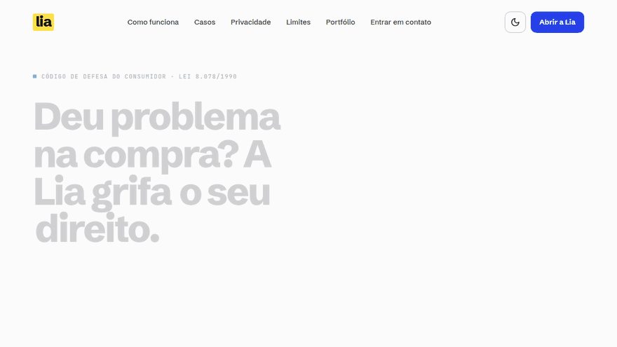](https://lia-consumidor.vercel.app)

A Lia ajuda quem teve problema com uma compra ou com um serviço. Você conta o que aconteceu
com as suas palavras, e ela descobre que tipo de caso é, pergunta o que faltar e devolve o
que a lei garante, quanto tempo você ainda tem para reclamar e um texto de reclamação pronto
para mandar à empresa, ao consumidor.gov.br ou ao Procon.

Não precisa instalar nada nem criar conta. Tudo roda no navegador.

| Para abrir | Endereço |
|---|---|
| A Lia, a conversa | [lia-consumidor.vercel.app/conversa.html](https://lia-consumidor.vercel.app/conversa.html) |
| O site do projeto | [lia-consumidor.vercel.app](https://lia-consumidor.vercel.app) |
| O design system | [lia-consumidor.vercel.app/design-system.html](https://lia-consumidor.vercel.app/design-system.html) |
| Os slides da apresentação | [slides/apresentacao.pptx](slides/apresentacao.pptx) |

> [!TIP]
> Para ver uma conversa inteira sem digitar nada, abra
> [conversa.html?exemplo=1](https://lia-consumidor.vercel.app/conversa.html?exemplo=1).
> Os exemplos vão de 1 a 4.

| Campo | Informação |
|---|---|
| Disciplina | Tendências em Ciência da Computação, UDF, 2026/2 |
| Unidade | 4, Aplicações e Limitações (agentes e ética) |
| Avaliação | A1, projeto final |
| Estudante | Brayan A. Pletsch |
| RGM | 38473585 |
| Turma | Engenharia de Software, N1, noturno (disciplina optativa) |
| Professora | Kadidja Valéria |
| Data | 26/11/2026 |

A tabela que liga cada tarefa da unidade a um arquivo está no [README da unidade](../README.md).

Neste documento:

1. [O problema](#1-o-problema)
2. [Como funciona, passo a passo](#2-como-funciona-passo-a-passo)
3. [Os casos que a Lia atende](#3-os-casos-que-a-lia-atende)
4. [Modelo generativo ou agente?](#4-modelo-generativo-ou-agente)
5. [Arquitetura em quatro camadas](#5-arquitetura-em-quatro-camadas)
6. [Do prompt estático ao dinâmico](#6-do-prompt-estático-ao-dinâmico)
7. [Memória](#7-memória)
8. [Privacidade, viés e ética](#8-privacidade-viés-e-ética)
9. [Especificação do chatbot](#9-especificação-do-chatbot)
10. [Testes](#10-testes)
11. [Vantagens e limitações](#11-vantagens-e-limitações)
12. [Próximos passos](#12-próximos-passos)
13. [O visual e o código da interface](#13-o-visual-e-o-código-da-interface)
14. [Como usar e como rodar](#14-como-usar-e-como-rodar)

## 1. O problema

Em 2024, o consumidor.gov.br finalizou 1.414.218 reclamações, e as empresas resolveram 82,32%
delas (boletim de 2024 da Senacon). Quando a reclamação chega, ela costuma dar resultado. O
difícil vem antes: saber se você tem direito, qual é o prazo e o que pedir.

O Código de Defesa do Consumidor (CDC), a lei que protege quem compra, tem prazos curtos e
alguns detalhes que confundem muita gente:

| Situação | O que a lei diz |
|---|---|
| Desistir de uma compra em 7 dias | Só vale para compra feita fora da loja: pela internet, por telefone ou em casa (art. 49). Numa loja física, trocar um produto sem defeito depende da política da loja. |
| Reclamar de um defeito | São 30 dias para o que acaba rápido e 90 dias para o que é feito para durar. Se o defeito estava escondido, o prazo conta a partir de quando ele apareceu (art. 26). |
| Receber em dobro uma cobrança errada | Vale para o que você já pagou a mais, e não para a cobrança em si (art. 42). |

Quem não conhece essas regras pode desistir antes da hora, reclamar fora do prazo ou pedir
uma coisa a que não tem direito. A Lia foi pensada para quem compra pela internet, recebe uma
fatura errada ou contrata um serviço mal feito, não tem advogado e não sabe por onde começar.

## 2. Como funciona, passo a passo

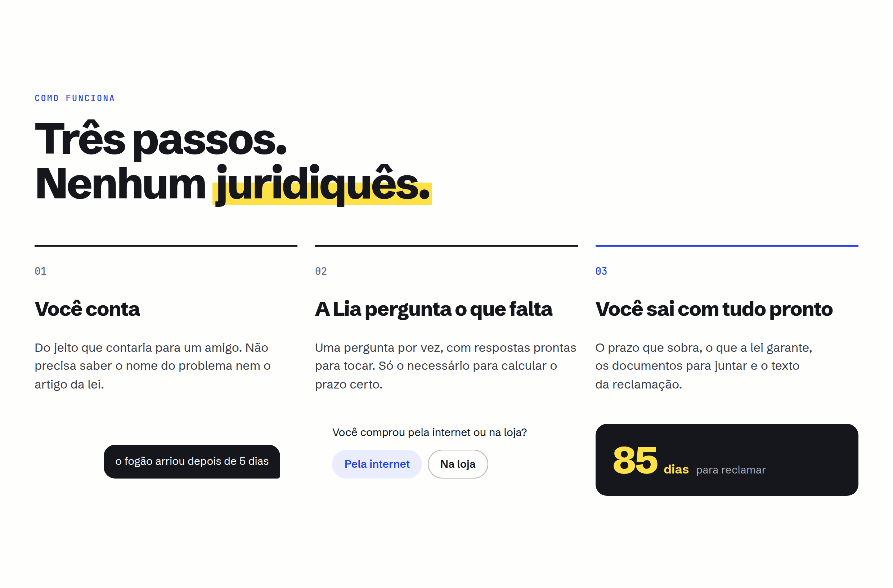

A conversa abaixo é a do exemplo 1: um fogão comprado pelo site que chegou e não liga.

### Você conta e a Lia pergunta o que falta

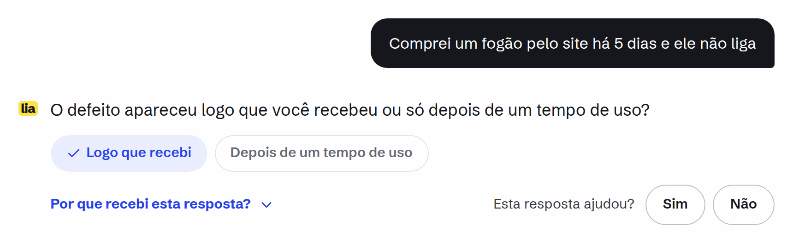

Você escreve como contaria para um amigo. Não precisa saber o nome do problema nem o artigo
da lei. Quando falta uma informação para calcular o prazo, a Lia faz uma pergunta por vez,
com botões de resposta rápida. Clicar num botão ou digitar a resposta dá no mesmo. Aqui ela
quer saber se o defeito apareceu logo, porque isso muda a contagem do prazo.

### O prazo aparece primeiro

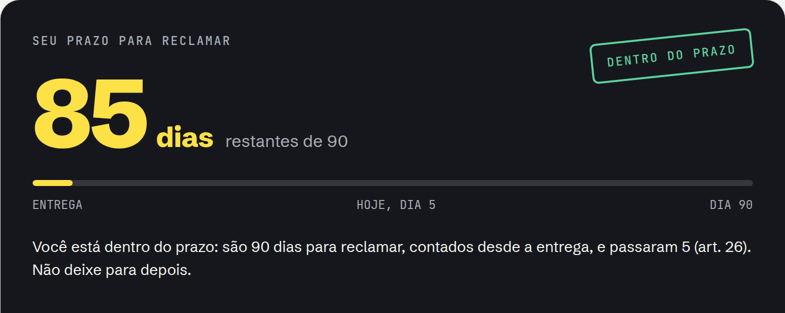

O prazo é a primeira coisa que a pessoa quer saber, então ele abre a resposta, em amarelo. O
fogão é feito para durar, e por isso o prazo é de 90 dias (art. 26). Como já passaram 5 dias
desde a entrega, restam 85. O selo verde confirma que a reclamação está dentro do prazo.
Quando o prazo já venceu, o número vira 0 e o selo fica vermelho.

### O que a lei garante

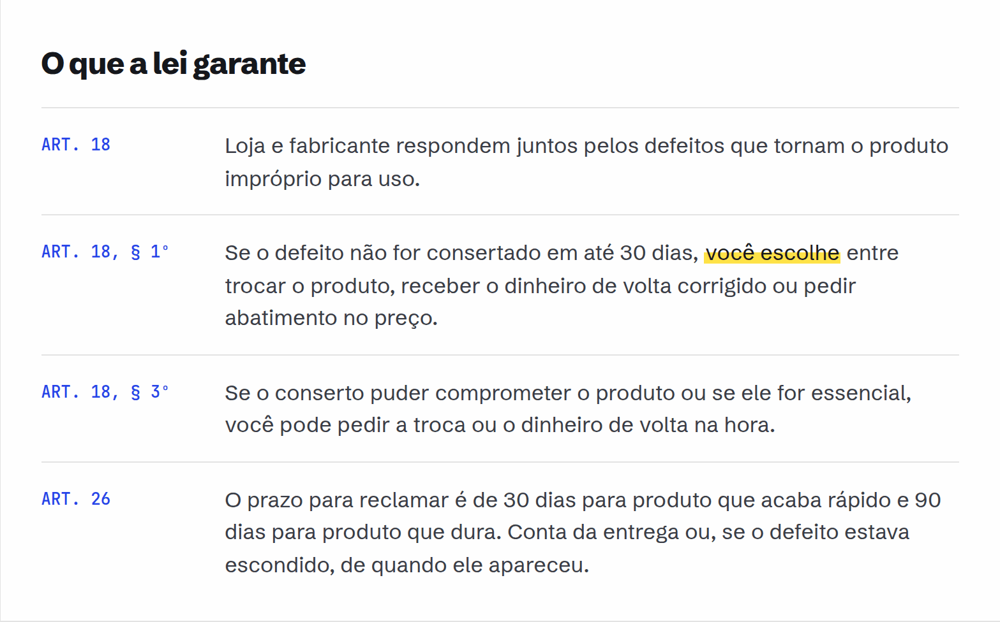

Cada artigo vem com uma frase em português do dia a dia. O trecho que decide o caso fica
grifado. No art. 18, § 1º, o grifo está em "você escolhe": se o defeito não for consertado
em 30 dias, quem decide entre trocar o produto, receber o dinheiro de volta ou pedir
abatimento no preço é você.

### O que fazer agora

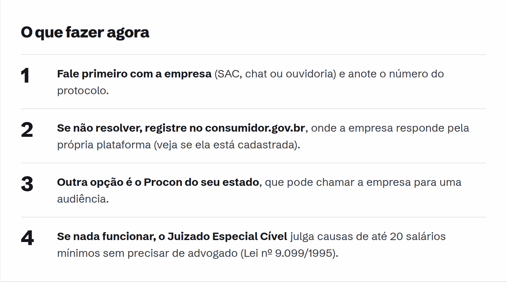

Os passos seguem uma ordem. Primeiro a empresa, anotando o número do protocolo. Se não
resolver, o consumidor.gov.br. Outra opção é o Procon do seu estado. Se nada funcionar, o
Juizado Especial Cível julga causas de até 20 salários mínimos sem precisar de advogado
(Lei 9.099/1995).

### Os documentos para juntar

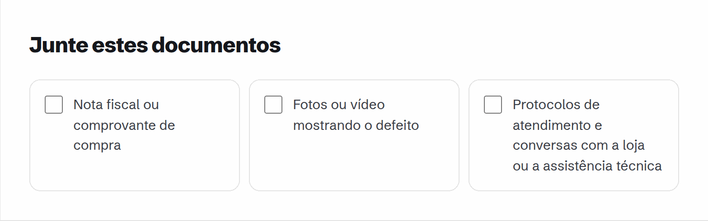

É uma lista para marcar, e ela muda conforme o caso. Para um produto com defeito, a Lia pede
a nota fiscal, fotos ou vídeo mostrando o defeito e os protocolos de atendimento.

### O texto da reclamação

![Texto da reclamação com os campos que faltam grifados em amarelo, como [nome da empresa], [data da compra] e [seu nome], e os botões Copiar texto e Baixar .txt](imagens/reclamacao.png)

A Lia escreve a reclamação com o que já sabe pela conversa. O que só você sabe, como o nome
da empresa e a data da compra, fica entre colchetes e grifado, para você completar. Dá para
copiar o texto ou baixar como arquivo .txt.

> [!IMPORTANT]
> A Lia não envia a reclamação. Quem decide mandar, e para onde, é sempre você.

### Por que recebi esta resposta?

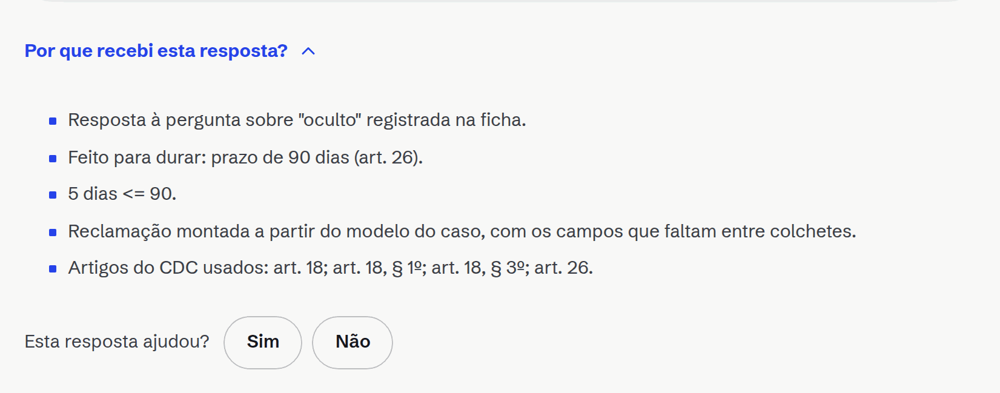

Toda resposta tem esse botão. Ele mostra as palavras que indicaram o caso, as regras
aplicadas, a conta do prazo, os artigos usados e a confiança da Lia na identificação. Se ela
errar, dá para ver em que ponto errou e discordar com base nisso. Embaixo, a pergunta "Esta
resposta ajudou?" alimenta o registro de curadoria (seção 9).

## 3. Os casos que a Lia atende

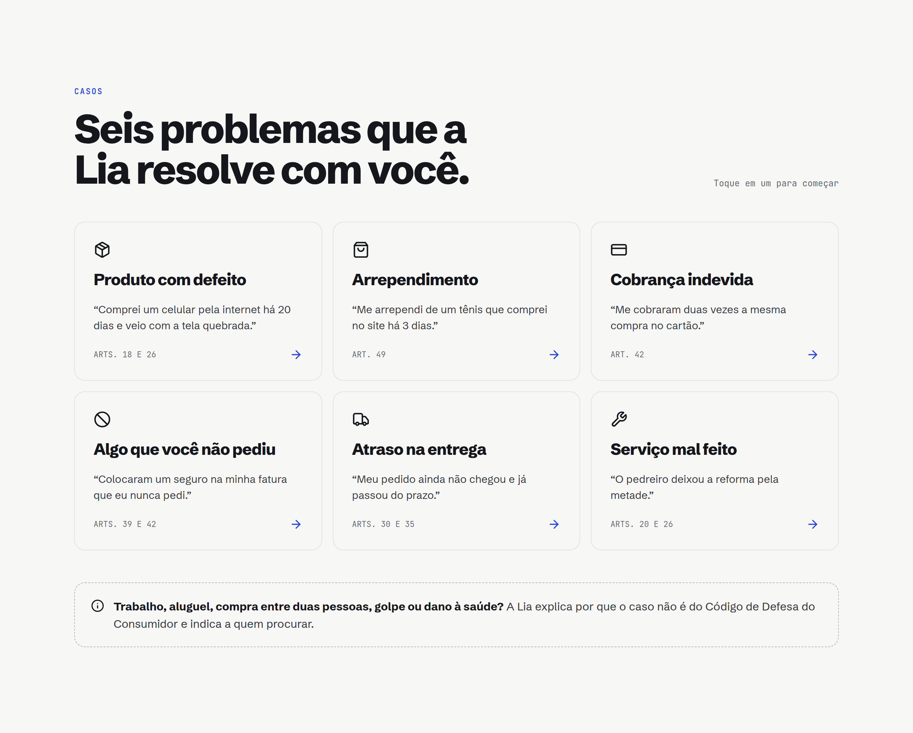

A Lia conhece seis tipos de caso. No site, cada cartão abre a conversa com um relato de
exemplo já escrito.

| Caso | Exemplo de relato | Base no CDC |
|---|---|---|
| Produto com defeito | "o celular veio com a tela quebrada" | arts. 18 e 26 |
| Arrependimento de compra | "comprei no site e não gostei, quero devolver" | art. 49 |
| Cobrança indevida | "me cobraram duas vezes no cartão" | art. 42 |
| Produto ou serviço que a pessoa não pediu | "colocaram um seguro que eu nunca pedi" | arts. 39 e 42 |
| Atraso na entrega ou oferta não cumprida | "meu pedido não chegou e já passou do prazo" | arts. 30 e 35 |
| Serviço mal feito | "o pedreiro deixou a obra pela metade" | arts. 20 e 26 |

A resposta muda de cara conforme a situação. Duas que aparecem nos exemplos da apresentação:

| Compra em loja física (exemplo 2) | Cobrança em dobro já paga (exemplo 3) |
|---|---|
| 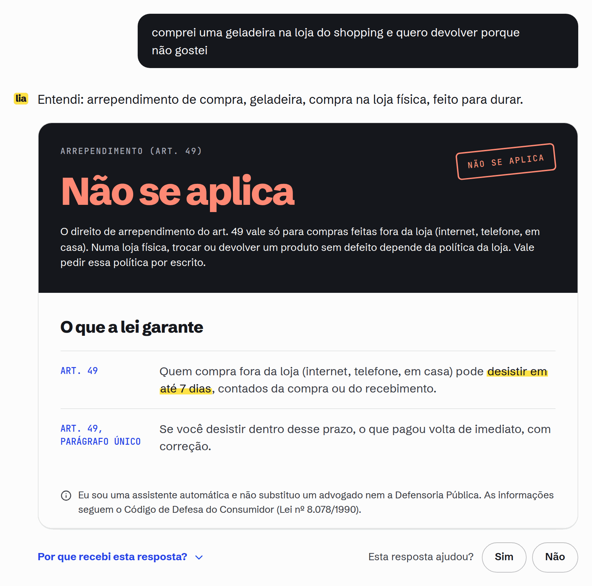 |  |
| A pessoa quer desistir de uma geladeira comprada no shopping. O art. 49 não vale para loja física, então a Lia explica isso e não monta reclamação, porque seria um pedido sem base. | Quem já pagou uma cobrança indevida pode pedir de volta o dobro do que pagou a mais, com correção e juros (art. 42, parágrafo único). |

### Quando o caso não é do CDC

Ela também reconhece cinco assuntos que o CDC não cobre ou que precisam de outro tipo de
ajuda. Nesses casos ela não orienta: explica por quê e diz a quem procurar.

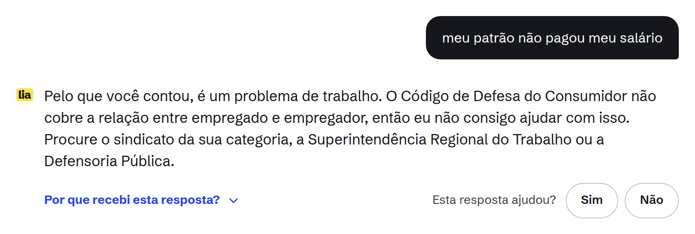

| Assunto | Para onde a Lia encaminha |
|---|---|
| Trabalho (patrão, salário, demissão) | sindicato, Superintendência Regional do Trabalho ou Defensoria |
| Aluguel | Defensoria Pública (o contrato segue a Lei do Inquilinato) |
| Compra entre duas pessoas | Juizado Especial Cível; boletim de ocorrência se houve golpe |
| Golpe | banco e boletim de ocorrência, antes de qualquer reclamação |
| Acidente ou dano à saúde | atendimento de saúde, Procon ou Defensoria |

A Lia também tem limites de propósito. Ela não manda a reclamação sozinha, não calcula
indenização, não guarda a conversa e não acessa nenhum sistema de empresa ou de governo.

## 4. Modelo generativo ou agente?

Um modelo generativo responde a um pedido de cada vez, sem guardar o que veio antes. Um
agente vai além: decide o que fazer, guarda o contexto da conversa e age para chegar a um
resultado. O guia da A1 separa os dois por esses três pontos, ação, contexto e autonomia.

A Lia se comporta como agente. Ela decide qual regra aplicar, pergunta o que falta, produz um
resultado (a orientação e a reclamação) e guarda o contexto do caso enquanto a conversa dura.
A última ação, que é enviar a reclamação, eu deixei de propósito com a pessoa: uma
reclamação mandada em nome de alguém, com um prazo calculado errado, causa um dano difícil de
desfazer.

A Lia não usa modelo de linguagem, a tecnologia que gera texto nos chatbots de IA. A parte
que entende o relato funciona com gatilhos (palavras e expressões que indicam cada caso) e
regras escritos por mim e conferidos no texto do CDC. Escolhi assim por três motivos:

- cada resposta pode ser explicada, que é o princípio da interpretabilidade do guia;
- nada do que a pessoa digita sai do computador dela;
- não existe custo por uso.

O preço dessa escolha aparece nos testes: com frases que ela nunca tinha visto, a Lia acertou
o caso em 4 de 12 (seção 10).

## 5. Arquitetura em quatro camadas

O guia descreve um agente em quatro camadas. Dá para pensar na Lia como uma atendente de
Procon que segue sempre a mesma ordem: escuta, entende, confere as regras e entrega a
resposta. Cada etapa é uma função no código, em
[agente/scripts/nucleo/agente.js](agente/scripts/nucleo/agente.js).

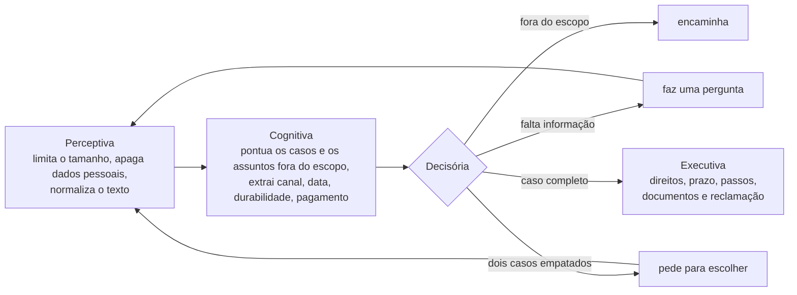

| Camada | Na atendente | O que faz na Lia | Função |
|---|---|---|---|
| Perceptiva | escuta | Lê até 1.000 caracteres, apaga CPF, telefone, e-mail e número de cartão antes de qualquer análise e normaliza o texto (deixa tudo em minúsculas e sem acento) | `perceber` |
| Cognitiva | entende | Dá pontos a cada caso conforme os gatilhos encontrados, aceita pequenos erros de digitação e descobre onde a compra foi feita, há quantos dias, se o produto dura, se a pessoa já pagou e se havia prazo de entrega | `entender` |
| Decisória | confere as regras | Encaminha os assuntos fora do escopo, escolhe o caso (com uma regra de prioridade e uma pergunta quando dois casos empatam), pergunta o que falta e aplica os prazos dos arts. 26 e 49 | `decidir` |
| Executiva | entrega a resposta | Monta a resposta: o que a lei garante, a situação do prazo, os passos, os documentos e o texto da reclamação | `executar` |

O botão "Por que recebi esta resposta?" (seção 2) mostra, em cada resposta, as palavras e as
regras que levaram a ela.

## 6. Do prompt estático ao dinâmico

Prompt é o texto de instrução que guia um sistema. Um prompt estático é sempre igual. O guia
mostra que, num agente, ele vira um modelo com espaços que vão sendo preenchidos durante a
conversa. Na Lia, o texto da reclamação funciona assim. Cada caso tem o seu modelo:

```
Em [data da compra], {comprei | contratei} {produto}{onde comprou}{valor}. {descrição do caso}

Por isso, peço {pedido do caso, com o artigo do CDC}.
```

As chaves `{ }` a Lia preenche com a ficha da conversa. Os colchetes `[ ]` ficam para a
pessoa, porque é algo que só ela sabe. No exemplo do fogão:

| Espaço | Quem preenche | No exemplo do fogão |
|---|---|---|
| `{produto}` | a Lia, pela ficha | fogão |
| `{onde comprou}` | a Lia, pela ficha | fora da loja física (internet, telefone ou em casa) |
| `{pedido do caso}` | a Lia, pela regra do caso | o conserto em até 30 dias (art. 18, § 1º) e, se não resolver, a troca ou a devolução do valor pago |
| `[nome da empresa]`, `[data da compra]`, `[descreva o defeito]`, `[seu nome]` | a pessoa | ficam grifados para completar |

Preferi deixar os colchetes a deixar a Lia supor um dado. O pedido também muda com a ficha.
Numa cobrança indevida que ainda não foi paga, por exemplo, ela pede o cancelamento da
cobrança, e não a devolução em dobro, que só vale para o que já foi pago.

## 7. Memória

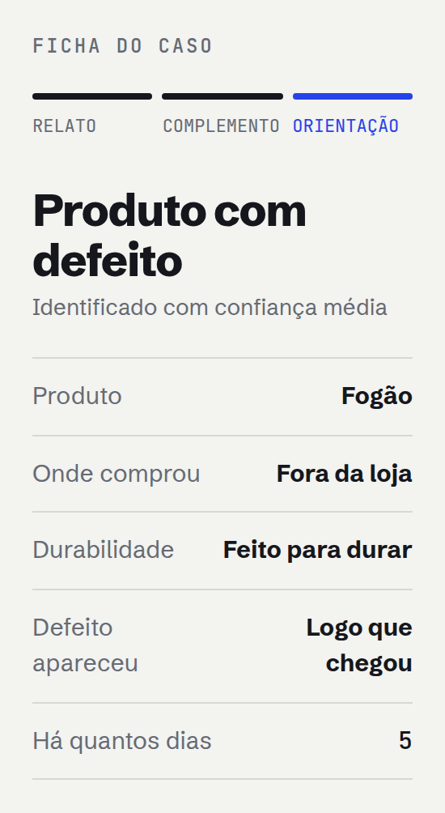

O guia fala de três níveis de memória. Quanto mais o agente lembra, mais contexto ele tem e
maior fica o risco para a privacidade.

| Memória | Na Lia | Por quê |
|---|---|---|
| Curta | As 6 últimas mensagens | É o que basta para entender a resposta a uma pergunta |
| Média | A ficha do caso: tipo, produto, onde comprou, há quantos dias, se pagou | Aparece no painel "Ficha do caso" e é apagada quando a orientação sai |
| Longa | Não existe | Guardar o histórico de reclamações de alguém cria um perfil de consumo e de conflitos, e a Lia não precisa disso |

A ficha fica no painel da esquerda. No celular, ela abre por um botão no topo da tela.

Abrir mão da memória longa tem um custo: se a pessoa voltar outro dia, precisa contar o caso
de novo.

<br clear="right">

## 8. Privacidade, viés e ética

A análise completa está em [etica-e-vies.md](etica-e-vies.md).

### Privacidade

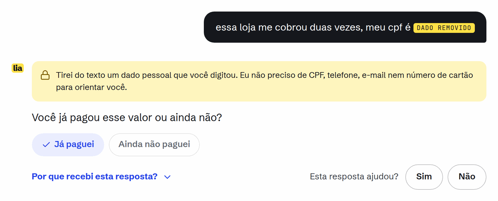

A Lia coleta o mínimo. Ela não pede nenhum dado pessoal e apaga CPF, telefone, e-mail e
número de cartão se a pessoa digitar, antes de qualquer análise. Nomes e endereços ela ainda
não reconhece, e isso está registrado como limitação. Como tudo roda no navegador, nada da
conversa é enviado nem guardado: fechou a página, o caso some.

> [!NOTE]
> A única parte do site que manda dados pela internet é o formulário de contato da página
> inicial, e ele avisa isso logo abaixo do botão de enviar. A conversa com a Lia não passa
> por ele.

### Viés

Viés é quando um sistema funciona melhor para um grupo de pessoas do que para outro. Para
medir isso, escrevi cada um dos seis casos de quatro jeitos (formal, informal, com erro de
digitação e com expressão regional) e contei quantos a Lia entendia em cada jeito.

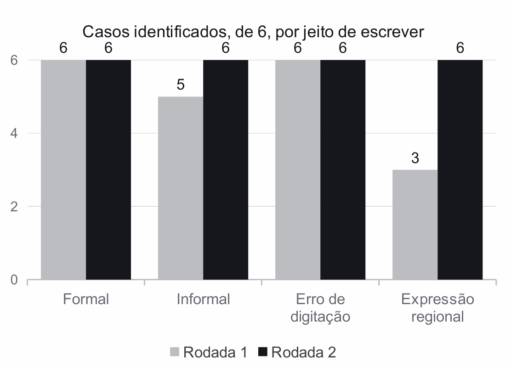

Os testes encontraram os três tipos de viés do guia:

| Tipo | O que aconteceu na Lia |
|---|---|
| De dados | Os gatilhos eram o meu jeito de falar. Na primeira rodada ela entendeu só 3 de 6 relatos com expressão regional ("arriou", "deu prego", "não veio", "serviço porco"). |
| De algoritmo | A tolerância a erro de digitação, uma escolha minha, fez "colocaram" virar "clonaram", e quem reclamava de um seguro não pedido era mandado para o tratamento de golpe. |
| De aplicação | Usar o CDC num problema de aluguel ou de trabalho daria uma orientação errada com cara de certa. Por isso existem os cinco assuntos fora do escopo. |

A correção do viés de algoritmo teve um custo, que o guia chama de custo da equidade: quem
digita "golpi" não é mais encaminhado para o tratamento de golpe.

### Ética

O documento de ética analisa três dilemas pelos três frameworks do guia (consequencialista,
deontológico e das virtudes) e confere a licença social para operar:

| Pilar | O que a Lia tem | O que falta |
|---|---|---|
| Accountability (responder pelo que faz) | Toda resposta cita o artigo e mostra a regra usada; o código é público; o aviso deixa claro que ela não é advogada | Uma instituição, como um Procon ou uma Defensoria, que responda pelo conteúdo |
| Participação | Nenhuma: os relatos dos testes foram escritos por mim | Ouvir consumidores de várias regiões e idades e alguém do Procon desde o desenho |
| Remediação (corrigir o erro) | Avaliação em cada resposta, explicação de cada decisão, encaminhamento ao Procon e reclamação editável | Um canal para contestar uma orientação depois que a conversa acaba |

O pilar mais fraco é a participação.

## 9. Especificação do chatbot

A especificação segue as 11 etapas do fluxo de trabalho do Serpro Bots e está em
[especificacao-do-chatbot.md](especificacao-do-chatbot.md).

| Etapa | Na Lia |
|---|---|
| 1. Entender a necessidade | Canvas e Documento de Visão |
| 2. Montar a estrutura | Pastas do repositório |
| 3. Identidade visual e persona | Lia, uma atendente de Procon, e o design system |
| 4. Coletar o acervo | CDC, Lei 9.099 e o boletim da Senacon |
| 5. Modelar | Seis intenções e o fluxo da conversa |
| 6. UX Writing | Textos sem juridiquês |
| 7. Implementar | HTML e JavaScript, sem servidor |
| 8. Testar | 55 testes e a validação com frases novas |
| 9. Homologar | Conferência contra os critérios de aceite |
| 10. Implantar | GitHub Pages e Vercel |
| 11. Fazer a curadoria | A avaliação de cada resposta e um registro sem o texto da pessoa |

O registro de curadoria fica no agente, na função `verRegistro()`, que os testes usam. A tela
não tem botão para baixá-lo.

## 10. Testes

A bateria fica em [agente/testes/testes.js](agente/testes/testes.js), e os resultados,
explicados um a um, em [casos-de-teste.md](casos-de-teste.md).

| Rodada | Resultado |
|---|---|
| Primeira, antes de qualquer ajuste | 46 de 53 testes |
| Segunda, depois de corrigir o viés de algoritmo e acrescentar as expressões regionais | 55 de 55 (53 originais e 2 de regressão) |
| Validação com 12 frases novas, que não foram usadas no ajuste | 4 de 12 casos identificados |

A bateria cobre a identificação dos seis casos escritos de quatro jeitos, os prazos e as
regras, os assuntos fora do escopo, a privacidade e testes adversariais, que tentam fazer a
Lia errar de propósito: pedir para ignorar as regras, pedir valor de indenização, xingar,
mandar mensagem vazia e mandar texto sem sentido. Os cinco adversariais passam.

A segunda rodada passa inteira porque eu acrescentei exatamente as expressões que tinham
falhado. A validação existe para medir isso: com frases que nunca viu, a Lia acerta pouco.
Em 7 dos 8 erros ela respondeu que não entendeu, pediu para a pessoa contar de outro jeito e,
na segunda vez, indicou o Procon. No oitavo ("o anúncio dizia frete grátis e me cobraram o
frete") ela tratou como cobrança indevida, com confiança baixa, o que não chega a ser absurdo
para esse relato.

## 11. Vantagens e limitações

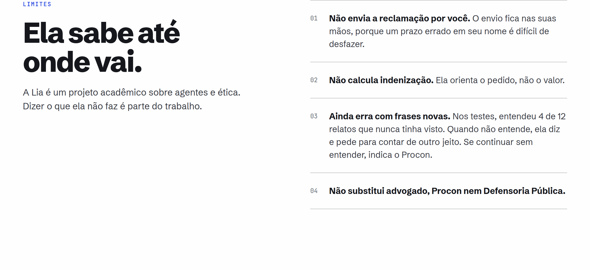

Vantagens:

1. Cada resposta pode ser explicada. A pessoa vê as palavras que contaram, a regra aplicada
   e o artigo usado, e pode discordar com base nisso.
2. Roda no navegador, sem custo, e o relato não sai do computador da pessoa. A página pode ser
   aberta num computador de biblioteca ou de um posto do Procon.
3. A Lia recusa quando não há base. Na compra em loja física ela explica que o art. 49 não se
   aplica e não gera uma reclamação que a pessoa perderia.

Limitações:

1. Generaliza mal. Gatilhos escritos à mão não cobrem o jeito como cada pessoa fala, e a
   validação mostrou isso (4 de 12).
2. Os prazos dependem do que a pessoa informa. Se ela errar a data, a Lia calcula errado.
3. Não testei com usuários reais. Os relatos dos testes foram escritos por mim, inclusive os
   regionais.

> [!WARNING]
> A Lia é um protótipo acadêmico. As orientações são só informativas e não substituem
> advogado, Procon nem Defensoria Pública.

## 12. Próximos passos

- Fazer a curadoria das 8 frases que a validação não entendeu e montar um conjunto de
  validação novo para medir de novo.
- Testar com pessoas de fora do curso, de preferência idosos e pessoas de outras regiões, e
  ouvir alguém do Procon sobre os casos mais comuns.
- Avaliar um modelo de linguagem só na camada cognitiva, para identificar o caso, mantendo a
  decisão nas regras. Isso melhoraria a generalização, mas o texto da pessoa passaria a sair
  do navegador, e o custo e o risco de erro do modelo entrariam na conta.
- Acrescentar casos de banco, telefonia e plano de saúde, que têm regras próprias além do
  CDC.

## 13. O visual e o código da interface

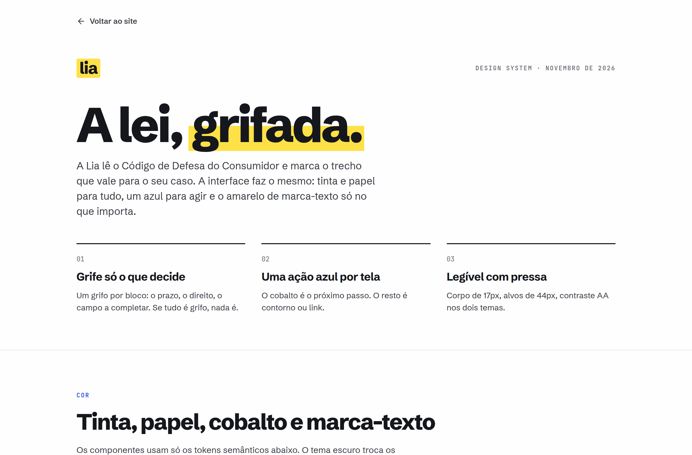

São três páginas, todas em `agente/`: o [site do projeto](agente/index.html), a
[Lia](agente/conversa.html) e o [design system](agente/design-system.html), que documenta as
cores, a tipografia, os movimentos e todos os componentes.

A ideia do visual é "a lei, grifada", como quem passa marca-texto no trecho da lei que
importa. Tinta e papel para quase tudo, um azul cobalto só para as ações (botões e links) e o
amarelo de marca-texto só no que decide, como o prazo e os campos que a pessoa precisa
completar.

<p>
  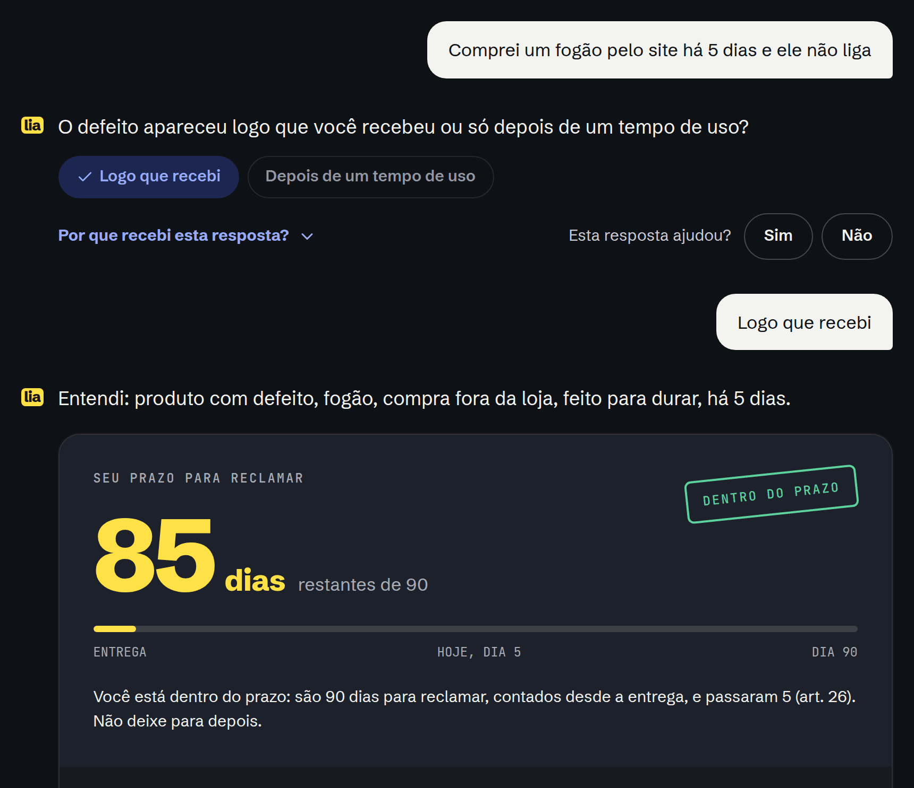
  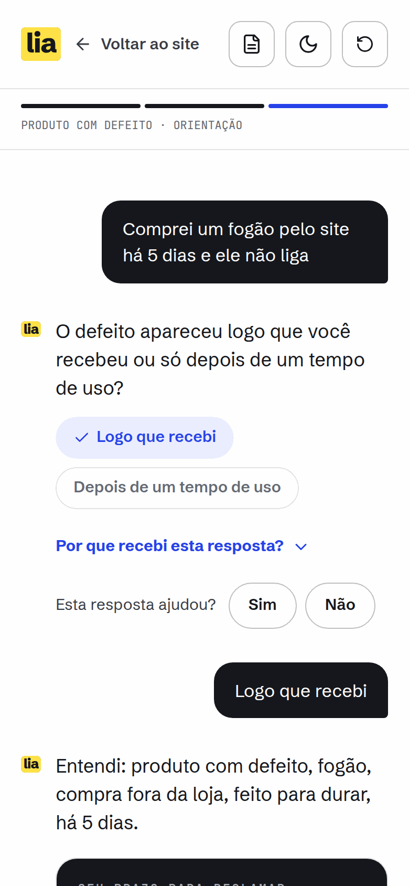
</p>

Tem tema claro e escuro, e o tema escolhido numa página vale na outra. No celular, a ficha
do caso vira uma gaveta e a barra de progresso fica no topo.

### Como o código está organizado

Os estilos começam por três arquivos que todas as páginas usam: `tokens.css` (as cores do
tema claro e do escuro), `base.css` e `componentes.css`. Depois vem o arquivo de cada página,
em `estilos/paginas/`. Os componentes usam só os tokens, então o tema escuro troca os valores
e nunca os nomes.

O JavaScript segue a mesma divisão. O núcleo (`scripts/nucleo/`) tem o agente e a base de
conhecimento e não mexe na tela, por isso roda também no Node, nos testes. Em `scripts/ui/`
ficam os ícones, o tema e os componentes, que recebem dados e devolvem elementos sem guardar
estado. Cada página tem o seu controlador em `scripts/paginas/`, com o mesmo nome do estilo
dela.

A página do design system usa os mesmos componentes e monta os exemplos pedindo respostas
reais ao agente, e a tabela de cores lê os valores do próprio `tokens.css`. Assim nada é
copiado à mão. Todo texto que vem da pessoa entra na página como texto puro, nunca como HTML,
então um relato com uma tag no meio aparece como texto e não altera a página.

Os ícones são SVG escritos no código, a partir do Lucide (licença ISC). As fontes Schibsted
Grotesk e JetBrains Mono vêm do Google Fonts; se elas não carregarem, a página usa a fonte do
sistema.

### Todas as telas

As telas inteiras, do jeito que o navegador mostra, ficam em [evidencias/](evidencias/):

| Tela | Arquivo |
|---|---|
| Site do projeto | [evidencias/landing.png](evidencias/landing.png) |
| Início da conversa, com os seis tipos de caso | [evidencias/inicio.png](evidencias/inicio.png) |
| Conversa completa sobre um fogão com defeito | [evidencias/demo-1.png](evidencias/demo-1.png) |
| Compra em loja física, sem reclamação | [evidencias/demo-2.png](evidencias/demo-2.png) |
| Cobrança em dobro com CPF digitado | [evidencias/demo-3.png](evidencias/demo-3.png) |
| Caso de trabalho, fora do escopo | [evidencias/demo-4.png](evidencias/demo-4.png) |
| Tema escuro | [evidencias/tema-escuro.png](evidencias/tema-escuro.png) |
| Celular | [evidencias/celular.png](evidencias/celular.png) |
| Design system | [evidencias/design-system.png](evidencias/design-system.png) |

## 14. Como usar e como rodar

### Pela internet

O jeito mais fácil é abrir [lia-consumidor.vercel.app](https://lia-consumidor.vercel.app). O
mesmo site também está no GitHub Pages do repositório, em
`https://brayanpletsch.github.io/Tendencias_CienciaComputacao_2026_2/unidade-4-aplicacoes-e-limitacoes/projeto-assistente-consumidor/agente/`.

### No seu computador

Baixe o repositório e abra no navegador o arquivo
[agente/index.html](agente/index.html), para ver o site, ou
[agente/conversa.html](agente/conversa.html), para ir direto para a Lia.

### Atalhos no endereço

Dá para acrescentar estes complementos ao endereço de `conversa.html`:

| Complemento | O que faz |
|---|---|
| `?exemplo=1` até `?exemplo=4` | Abre uma conversa pronta: fogão com defeito, compra em loja física, cobrança em dobro com CPF digitado e um caso de trabalho |
| `?relato=...` | Abre a Lia com o relato já escrito no campo, sem enviar. É o que os cartões de caso do site usam |
| `&tema=escuro` ou `&tema=claro` | Força um dos temas |
| `&foto` | Mostra a página inteira, sem rolagem interna. As telas de `evidencias/` foram tiradas assim |

### Os testes

Para rodar os testes é preciso ter o Node.js 18 ou mais novo:

```bash
cd unidade-4-aplicacoes-e-limitacoes/projeto-assistente-consumidor/agente
node testes/testes.js            # mostra o resultado
node testes/testes.js --salvar   # também grava testes/resultado-dos-testes.txt
```

### O formulário de contato

O formulário da página inicial usa o FormSubmit. Na primeira mensagem, o serviço manda para
o endereço do formulário um e-mail de ativação, que precisa ser confirmado. Depois disso ele
envia um código que pode substituir o endereço no `action` do formulário.

## Estrutura

```
projeto-assistente-consumidor/
├── README.md                      este documento
├── especificacao-do-chatbot.md    as 11 etapas do fluxo do Serpro Bots
├── etica-e-vies.md                privacidade, viés, frameworks éticos e licença social
├── casos-de-teste.md              rodadas de teste, validação e equidade
├── agente/
│   ├── index.html                 o site do projeto
│   ├── conversa.html              a Lia, a tela da conversa
│   ├── design-system.html         cores, tipos, movimentos e componentes
│   ├── favicon.svg, favicon.ico   ícone da aba (e apple-touch-icon.png, para o celular)
│   ├── estilos/
│   │   ├── tokens.css             cores e sombras do tema claro e do escuro
│   │   ├── base.css               reset, foco, rolagem e utilitários
│   │   ├── componentes.css        peças usadas pelas três páginas
│   │   └── paginas/               landing.css, conversa.css, design-system.css
│   ├── scripts/
│   │   ├── nucleo/                agente.js (as quatro camadas) e base-conhecimento.js
│   │   ├── ui/                    icones.js, tema.js e componentes.js
│   │   └── paginas/               landing.js, conversa.js, design-system.js
│   └── testes/                    testes.js e resultado-dos-testes.txt (saída da última execução)
├── imagens/                       recortes das telas e o GIF da página inicial, usados nos READMEs
├── evidencias/                    telas inteiras do site, da Lia e do design system
└── slides/apresentacao.pptx       apresentação final
```

## Uso de IA

Usei o Claude (Anthropic) como apoio para programar o agente, gerar as telas e os slides e
escrever e revisar os textos. O visual foi desenhado com o Claude Design e implementado com o
Claude Code. As regras jurídicas foram conferidas no texto oficial do CDC, e os números de
teste citados aqui vêm da execução de [agente/testes/testes.js](agente/testes/testes.js). A
Lia em si não usa IA generativa.

## Referências

- BRASIL. Lei nº 8.078, de 11 de setembro de 1990. Código de Defesa do Consumidor.
  https://www.planalto.gov.br/ccivil_03/leis/l8078compilado.htm
- BRASIL. Lei nº 9.099, de 26 de setembro de 1995. Juizados Especiais Cíveis e Criminais.
- BRASIL. Ministério da Justiça e Segurança Pública. Senacon. Boletim Consumidor.gov.br 2024.
  https://www.gov.br/mj/pt-br/assuntos/seus-direitos/consumidor/defesadoconsumidor/Biblioteca/boletins-1/boletim-consumidor-gov-br-2024.pdf
- SERPRO. Serprobots: fluxo de trabalho para desenvolver chatbots.
  https://serprobots.estaleiro.serpro.gov.br/docs/dev/
- OLIVEIRA, Kadidja Valéria Reginaldo de. Guia de estudos A1: criação de agentes de IA e ética
  aplicada. 2026. Em [../material/](../material/).
