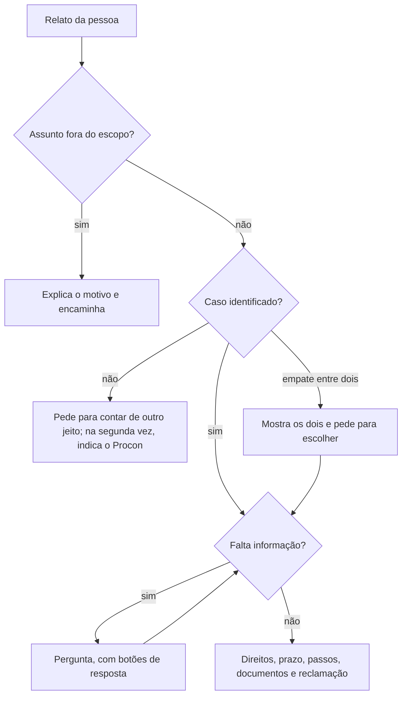

# Especificação do chatbot

Entrega de 12/11 da Unidade 4 (chatbot e ferramentas de chatbot, com a especificação). A
especificação segue as 11 etapas do
[fluxo de trabalho do Serpro Bots](https://serprobots.estaleiro.serpro.gov.br/docs/dev/),
que foi o material da aula de 05/11.

O Serpro Bots é uma plataforma contratada por órgãos públicos, e eu não tenho acesso a ela.
Por isso usei o fluxo de trabalho como roteiro do projeto e implementei o motor de conversa
por conta própria, em JavaScript. Onde uma etapa depende da plataforma ou de um cliente, digo
o que fiz no lugar.

## 1. Entender a necessidade

O fluxo pede para separar o problema, a necessidade, as motivações e o que o chatbot vai e
não vai resolver.

Canvas do chatbot:

| Item | Conteúdo |
|---|---|
| Problema | Quem tem um problema de consumo não sabe se tem direito, qual é o prazo nem o que pedir, e desiste ou reclama mal |
| Necessidade | Transformar o relato da pessoa numa orientação baseada no CDC e numa reclamação pronta |
| Motivação | O Consumidor.gov.br resolveu 82,32% das reclamações finalizadas em 2024, mas a reclamação precisa chegar lá bem feita e dentro do prazo |
| Usuários | Consumidores sem advogado, que escrevem do próprio jeito, às vezes com erro e com expressões regionais |
| O chatbot resolve | Identifica seis tipos de caso, aplica os prazos dos arts. 26 e 49, explica o direito e monta a reclamação |
| O chatbot não resolve | Não envia a reclamação, não calcula indenização, não atende trabalho, aluguel, compra entre pessoas, golpe nem acidente |
| Canal | Página web que roda no navegador, sem servidor |

Documento de visão (resumo):

- Objetivo: orientar a primeira reclamação de consumo de uma pessoa leiga, do relato ao texto
  pronto, em poucas trocas de mensagem.
- Critérios de aceite: identificar o caso nos relatos de teste em quatro registros de
  linguagem (formal, informal, com erro de digitação e regional); nunca gerar reclamação sem
  base legal; não guardar dados pessoais; explicar cada resposta.
- Estimativa inicial: um dia de trabalho para a primeira versão, porque o prazo da A1 era
  26/11. Isso definiu o tamanho do escopo: seis casos e cinco encaminhamentos.

Avaliei também se conversa era a melhor forma de atender a necessidade, como o fluxo
recomenda. Um formulário com perguntas fixas seria mais simples, mas obrigaria a pessoa a
saber de antemão em que tipo de caso ela se encaixa, e é isso que ela normalmente não sabe.
A conversa deixa ela contar do jeito dela.

## 2. Montar a estrutura

O fluxo sugere uma pasta por tipo de material. Adaptei para o repositório:

| Pasta sugerida pelo Serpro | Onde ficou |
|---|---|
| Acervo oficial | Texto do CDC e boletim da Senacon, citados nas referências do [README](README.md) |
| Id. visual e persona | Seção 3 deste documento, [agente/estilos/tokens.css](agente/estilos/tokens.css) e o [design system](agente/design-system.html) |
| Modelagem | [agente/scripts/nucleo/base-conhecimento.js](agente/scripts/nucleo/base-conhecimento.js) e a seção 5 deste documento |
| Testes | [agente/testes/testes.js](agente/testes/testes.js) e [casos-de-teste.md](casos-de-teste.md) |
| Divulgação | [slides/apresentacao.pptx](slides/apresentacao.pptx) |
| Entregas | [evidencias/](evidencias/) |
| Versões do modelo | o histórico do git |

## 3. Identidade visual e persona

Perfil da Lia:

| Traço | Definição |
|---|---|
| Nome | Lia |
| Inspiração | uma atendente experiente de balcão do Procon, que já ouviu de tudo |
| Tipo de fala | frases curtas, sem juridiquês, trata a pessoa por "você" |
| Comportamento | calma mesmo quando a pessoa está irritada; admite quando não sabe; nunca promete resultado |
| Limites | não dá opinião sobre a empresa, não estima indenização, não escreve ameaça |

Linha artística: "a lei, grifada". A Lia lê o CDC e marca o trecho que vale para o caso, e a
tela faz o mesmo. Tinta (`#15171C`) e papel (`#FFFFFF`) para quase tudo, um azul cobalto
(`#2643E9`) só para as ações e o amarelo de marca-texto (`#FFE247`) só no que decide: o prazo,
o grifo nos artigos, os campos a completar na reclamação e a própria marca, "lia" em
minúsculas sobre o amarelo, que também faz o papel de avatar nas mensagens. As fontes são a
Schibsted Grotesk, para títulos e texto, e a JetBrains Mono, para artigos e rótulos.

A situação do prazo aparece num bloco escuro, com o número de dias em amarelo e um carimbo com
o nome da situação: "Dentro do prazo" em verde, "Prazo vencido" e "Não se aplica" em
vermelho, "Confira a data" em amarelo. Nos casos sem prazo, como a cobrança indevida, o bloco
mostra o direito da pessoa. A mesma situação também existe em selos, cada um com cor, ícone e
texto: verde com um visto para "Dentro do prazo" e "Seu direito", amarelo com um triângulo
para "Confira a data", vermelho com um relógio para "Prazo vencido" e vermelho com um X para
"Não se aplica". A palavra no carimbo e no selo garante que a informação não dependa só da
cor.

A identidade completa (as cores dos dois temas, a tipografia, a marca, os ícones, os
movimentos e todos os componentes funcionando) está na página do
[design system](agente/design-system.html), e os valores das cores ficam em
[agente/estilos/tokens.css](agente/estilos/tokens.css).

Diálogos de exemplo:

| Situação | Fala da Lia |
|---|---|
| Saudação | "Oi, eu sou a Lia. Ajudo você a entender seus direitos numa compra ou num serviço que deu problema e a montar a reclamação [...] Conte o que aconteceu do seu jeito." |
| Não entendeu | "Não consegui identificar o tipo de problema. Pode contar com outras palavras? Diga o que comprou ou contratou e o que deu errado." |
| Pessoa irritada | "Entendo a raiva, esse tipo de problema cansa. Mesmo assim, vou manter a reclamação num tom educado [...]" |
| Despedida | "Boa sorte com a reclamação. Se precisar, é só contar outro problema." |

## 4. Coletar o acervo

| Fonte | Tipo | Uso |
|---|---|---|
| Lei nº 8.078/1990 (CDC), arts. 18, 20, 26, 30, 35, 39, 42 e 49, no site do Planalto | legislação, acervo oficial | regras e prazos de cada caso |
| Lei nº 9.099/1995 | legislação | limite de 20 salários mínimos para o Juizado sem advogado |
| Boletim Consumidor.gov.br 2024 (Senacon) | dados públicos | dimensão do problema |
| Guia de estudos A1 da professora | material didático | arquitetura, memória, privacidade, viés e ética |

O fluxo pede que o acervo não tenha dados pessoais. Nenhuma das fontes tem, e os relatos de
teste foram escritos por mim, sem nomes nem documentos reais.

## 5. Modelar o chatbot

O fluxo deixa escolher entre diálogos, IA generativa ou um modelo híbrido. Escolhi diálogos
com regras, pelos motivos da seção 3 do [README](README.md): explicação de cada resposta,
nenhum dado saindo do navegador e custo zero.

Linhas temáticas: um tema (relações de consumo), cinco assuntos (produto, compra, cobrança,
entrega e serviço) e seis intenções. Os assuntos fora do escopo funcionam como intenções de
encaminhamento.

Fluxo conversacional:

Design conversacional:

| Intenção | Frases que ativam (exemplos) | Perguntas de complemento | Resultado |
|---|---|---|---|
| Produto com defeito | "veio com defeito", "pifou", "não liga", "quebrou", "arriou" | dura ou acaba rápido? apareceu logo ou depois de um tempo? há quantos dias? | arts. 18 e 26, prazo de 30 ou 90 dias, reclamação pedindo conserto em até 30 dias |
| Arrependimento | "me arrependi", "quero devolver", "não gostei", "mudei de ideia" | comprou na loja ou fora dela? há quantos dias? se comprou há mais de 7 dias, quando o produto chegou? | art. 49; em loja física explica que não se aplica e não gera reclamação |
| Cobrança indevida | "me cobraram duas vezes", "valor que não reconheço", "cobrou a mais" | já pagou? | art. 42; devolução em dobro se já pagou, contestação se não pagou |
| Produto ou serviço não pedido | "não contratei", "nunca pedi", "sem minha autorização" | já pagou? | arts. 39 e 42; amostra grátis se não pagou, devolução em dobro se pagou |
| Atraso ou oferta não cumprida | "não chegou", "diferente do anunciado", "passou do prazo" | a loja informou prazo? | arts. 30 e 35; se não houve prazo, orienta pedir uma data por escrito |
| Serviço mal feito | "mal feito", "pela metade", "instalaram errado", "serviço porco" | dura ou acaba rápido? há quantos dias terminou? | arts. 20 e 26 |
| Fora do escopo | "patrão", "aluguel", "OLX", "golpe", "me machuquei" | nenhuma | explica por que não orienta e diz a quem procurar |
| Saudação, ajuda, despedida | "oi", "como funciona", "obrigado" | nenhuma | texto fixo |
| Regras de conduta | pedido de indenização, xingamento, CPF digitado, "ignore suas regras" | nenhuma | recusa calcular indenização, mantém o tom educado, apaga o dado e avisa, ignora o pedido |

Os gatilhos completos, com os pesos, estão em
[agente/scripts/nucleo/base-conhecimento.js](agente/scripts/nucleo/base-conhecimento.js). Quando dois casos aparecem
juntos com pontuação parecida, vale uma regra de precedência: "não pedi" ganha de
"cobrança", e "defeito" ganha de "arrependimento", porque o caso mais específico traz o
direito mais forte. Sem regra de precedência, a Lia pergunta qual dos dois é.

## 6. UX Writing

Regras que segui nos textos da Lia:

- uma ideia por frase, sem intercalar explicação no meio;
- nenhum termo jurídico sem tradução. O CDC fala em "vícios aparentes ou de fácil
  constatação" e em "repetição do indébito"; a Lia fala em "defeito que dá para ver" e
  "devolução em dobro";
- a saudação diz o que a Lia sabe fazer e dá um exemplo, como o fluxo recomenda para
  gerenciar a expectativa;
- toda pergunta de complemento tem botões com as respostas possíveis, para a pessoa não ter
  que adivinhar o formato.

Exemplo de reescrita:

| Antes | Depois |
|---|---|
| "O direito de reclamar pelos vícios aparentes ou de fácil constatação, nos termos do art. 26, inciso II, é de noventa dias para produtos duráveis." | "Você está dentro do prazo: são 90 dias para reclamar, contados desde a entrega, e passaram 5 (art. 26)." |

O fluxo sugere negrito para destacar o mais importante. Na Lia, o destaque é visual: o prazo
abre a orientação, num bloco escuro com o número de dias em amarelo e o carimbo da situação,
logo depois do resumo do caso. Nos artigos, a expressão que decide o caso ("você escolhe", "em
dobro", "desistir em até 7 dias") aparece grifada, e cada passo começa com o trecho principal
em negrito.

## 7. Implementar o chatbot

A implementação está em [agente/](agente/): as quatro camadas em `scripts/nucleo/agente.js`,
a base de conhecimento em `scripts/nucleo/base-conhecimento.js`, os estilos em `estilos/` e a
tela em `conversa.html`, com os componentes de `scripts/ui/` e o controlador
`scripts/paginas/conversa.js`. A página de apresentação, `index.html`, explica o projeto e leva
para a Lia. Os componentes da tela são funções que recebem dados e devolvem
elementos, e um controlador guarda o estado da conversa. Todo texto que a pessoa digita é
inserido na página como texto puro, nunca como HTML. Assim, um relato com uma tag no meio
aparece como texto e não altera a página.

## 8. Testar o chatbot

O fluxo pede testes com frases que não foram usadas no treino, com fluxos de exceção e com
ambiguidades, além de uma bateria para regressão. A bateria tem 55 testes, e as frases novas
ficaram num conjunto de validação separado. Os resultados estão em
[casos-de-teste.md](casos-de-teste.md).

Conferi também as máximas de Grice que o fluxo cita:

| Máxima | Como a Lia atende |
|---|---|
| Quantidade | Pergunta uma coisa por vez e só o que muda a regra aplicada |
| Qualidade | Cada direito citado vem do texto do CDC, com o artigo |
| Relevância | Quando o assunto não é de consumo, encaminha em vez de forçar uma resposta |
| Modo | Linguagem simples, educada mesmo diante de xingamento |

## 9. Homologar o chatbot

Não houve um demandante para dar o aceite formal. No lugar, conferi a versão final contra
os critérios de aceite do documento de visão (seção 1) e rodei o conjunto de validação. Uma
homologação de verdade teria alguém do Procon ou de um núcleo de defesa do consumidor
explorando os casos com relatos reais, e esse é o primeiro dos próximos passos do projeto.

## 10. Implantar o chatbot

A versão 1.0 está no repositório, datada de 26/11/2026. Para publicar, basta ligar o GitHub
Pages; o endereço está na seção 12 do [README](README.md). Como não há servidor nem banco de
dados, publicar é só servir os arquivos da pasta `agente/`.

## 11. Realizar a curadoria

A curadoria precisa saber o que a Lia não entendeu e se as respostas ajudaram, sem guardar o
que as pessoas escreveram. Por isso:

- cada resposta tem os botões "Esta resposta ajudou? Sim / Não";
- o agente guarda um registro da sessão com o número da resposta, o tipo (pergunta,
  orientação, fora do escopo, não entendeu), o caso e a avaliação, sem o texto digitado. O
  registro fica na memória da página, é lido pela função `verRegistro()` do agente, que os
  testes usam, e some quando a página é fechada. Esta versão não tem botão para exportar o
  registro.

O primeiro ciclo de curadoria aconteceu durante os testes. A rodada 1 mostrou as expressões
regionais que a Lia não entendia e dois falsos positivos da tolerância a erro de digitação;
a rodada 2 confirmou a correção sem regressão. As oito frases que a validação não entendeu
são a entrada do próximo ciclo.
